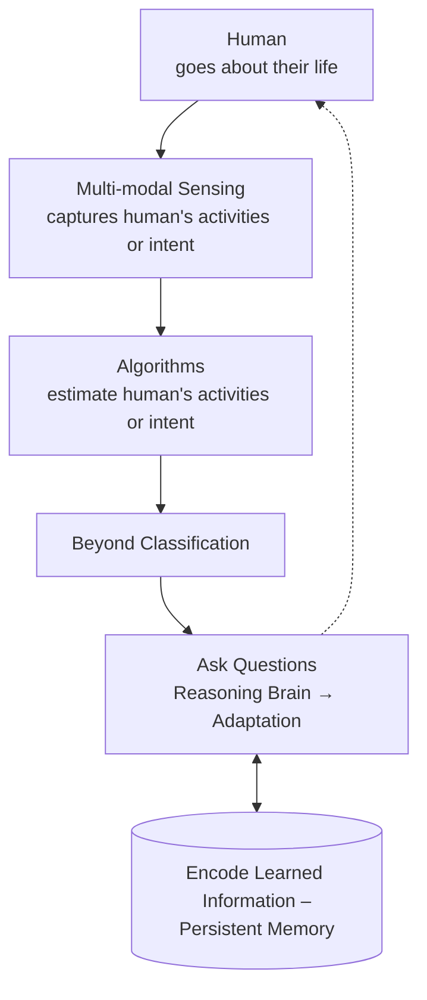

Dr. Sreenivasan Ramasamy Ramamurthy, Bowie State University. Seminar talk "Toward Human-Centered Intelligent Systems: From Sensing to Collaborative Autonomy," Texas Tech University Computer Science Graduate Seminar (CS 5120), 29 September 2026.

**Abstract.** We envision a human-centered intelligent system that senses a person at home, goes beyond classifying their activity, and uses a reasoning "brain" with persistent memory, all on a resource-constrained device. In Part 1, wrist-worn sensor data from the homes of 25 older adults with symptoms of dementia or neurodegenerative disorders, mostly unlabeled, are used for activity recognition. Self-taught learning raises the weighted F1-score from 54% to 86%. A contrastive multitask network predicts activity and health status together, and its missed activity detections form an impairment indicator that is highest (10–23%) for mild cognitive impairment. In Part 2, small vision-language models on Jetson Orin hardware narrate manipulation tasks and give instructions; contact-sheet inputs are 1.4–9.4× faster with no loss of quality, but no small model detects mistakes reliably yet. Ongoing work adds knowledge distillation and a knowledge graph.

*This article is a journal-style write-up of the seminar as delivered. Its content, claims and results are the presenter's; the wording is an adaptation of the recorded talk and slides.*

## 1. Introduction

The research is in human-centered intelligent systems with a focus on health: using sensors to detect people's activities and asking what more those activities reveal, such as an underlying disease. The newer direction is to feed sensor information into a "brain" that correlates it and makes decisions, which raises questions of human-machine and machine-machine collaboration on resource-constrained devices.

Interaction with sensors has moved from reading a thermostat, through touchscreens and immersive VR, to wearables and sensors throughout the home. The talk proposes using home sensors for something more important than turning off lights: health. The slide summarized: "Reliance of Sensor System → Greater Awareness → Informed decisions [specifically personalized and with less effort]."

### 1.1 Many scenarios

Besides the smart home, the main subject of the talk, Ramamurthy showed a robot on a collaborator's farm in Maryland that records data about the plants, such as whether they need water, with the goal of navigating autonomously and returning a report. He also showed the smart soldier, from research funded by the Army Research Lab. In both, sensors augment human limits.

### 1.2 Scenario #1: Older adults

Older adults Ramamurthy met during data collection were receptive to sensor systems at home. The slide reported that 75% of U.S. adults aged 50 and over want to remain in their current home as they age (AARP 2024 Home & Community Preferences Survey). He added that falls become more common with age and that a study found 65% of adults aged 50 and over willing to use a system that monitors them and keeps them safe. In one story, a very active participant fell without their wearable call button and was helped only when a routine check-in came hours later.

In the motivating scenario ("Let me go about my day"), a robot observes ordinary movement, analyzing gait, standing and walking "without asking the person to perform a separate test," since a person asked to walk again corrects themselves. If something looks wrong, it compares the person's watch data with their baseline, asks "Are you OK?", then whether they would like to check in with someone, and depending on severity alerts a caregiver. This requires a wearable that detects activities against a baseline, a networked decision-making brain, and a robot camera that recognizes activity, all on a small edge device.

## 2. A framework for human-centered intelligent systems

A human goes about their life; multi-modal sensing (wearables, cameras, LiDAR, mmWave radar, Wi-Fi) captures their activities or intent; algorithms estimate them. Alone, this is "a one-way street." Going *beyond classification* extracts more, such as signs of a health condition, and feeding that back to the human makes a loop, but one that cannot adapt. Adaptation needs a brain that asks questions, learns, and updates a persistent memory, and "this framework should fit on a resource constrained device." Part 1 of the talk covers sensing through beyond-classification; Part 2 covers the brain and memory.

*Figure 1. Redrawn from the presenter's framework slide. Part 1 is the path from the human to beyond classification; Part 2 is the reasoning brain and persistent memory.*

Part 1 tests two hypotheses from the slide:

- **H1:** In-the-wild wearable sensor streams from older adults contain enough signal to reliably recognize ADLs and IADLs, even when labeled data is limited.
- **H2:** Beyond identifying the activity, wearable sensor streams also capture how well an activity is performed, and these performance errors reflect underlying cognitive and functional impairment.

The data are in the wild: collected in each participant's own home rather than a controlled environment. For H2, walking while limping still contains the accelerometer pattern of walking plus extra signal, which can grow large enough that the activity is detected incorrectly.

## 3. Background

### 3.1 Human activities

People perform the same activity differently. Simple activities (activities of daily living, ADLs) such as walking or jogging repeat a pattern; for jogging, signal power is consistent across the time scale. Complex activities (instrumental activities of daily living, IADLs) such as cooking or laundry are simpler activities aligned in time: walking to the clothes, carrying them, bending, loading the machine. Because laundry contains walking, it can be detected as walking.

### 3.2 Reasons that hurt classification algorithms

1. **Limited labeled data**, with much more unlabeled data, restricts which algorithms can be used.
2. **Imbalanced classes:** people walk often but brush their hair perhaps once a day, and "imagine brushing your hair for like 20 minutes" to collect more samples.
3. **Overlap:** t-SNE plots of the raw input show some structure with 4 activities, more overlap with 8, and "completely inseparable" data with 14.

*Figure 2. Redrawn from the presenter's slide 20 ("Reasons That Hurt Classification Algorithms"): share of labeled and unlabeled data, and distribution of the 14 activity classes. Values were read off the chart and are approximate.*

## 4. Methods

### 4.1 Data collection

Inclusion criteria were N = 25, age over 65, and symptoms of dementia or neurodegenerative disorders. Ramamurthy noted that dementia is not a disease but a set of symptoms, such as forgetfulness and confusion, associated with neurodegenerative disorders. Ten participants lived with mild cognitive impairment (MCI), eight lived with dementia, and the rest were normal controls, itself an uneven distribution.

- **Wearable:** Empatica E4 research-grade wristband with an inertial measurement unit (accelerometer, gyroscope, magnetometer), skin temperature, and electrodermal activity, which reflects the body's response to stressors.
- **Ambient sensors:** reed switches, PIR sensors and sensor tags, shown on the home layout with the cameras.
- **Clinical data:** a social worker administered the SLUMS examination (screening for dementia, e.g. drawing a clock and recalling five words), the Barthel scale (functional performance of ADLs) and the Lawton IADL examination, whose scripted activities were recorded with the sensors.
- **Ground truth:** under IRB regulations, cameras could record only four hours per participant, covering the scripted and then unscripted activities. The wristband stayed on for 24 hours, giving about 4 hours of labeled and 20 hours of unlabeled data.

### 4.2 Self-taught learning

The first method uses the unlabeled data through self-taught learning. Discrete wavelet transform (DWT) features feed a deep belief network (DBN), a stack of restricted Boltzmann machines trained greedily, layer by layer, until each layer's loss is acceptable. The hypothesis is that this pre-training removes noise and keeps the core activity patterns. Weights are then transferred to supervised training on the labeled data and a classifier. In the learned space, previously overlapping points group by pattern and the labeled examples fall into those groups.

### 4.3 Contrastive multitask learning

Layer-wise pre-training is computationally costly, so the second method uses only labeled data, and pushes same-class points together and different-class points apart. Ramamurthy said his group was "one of the first groups to talk about contrastive multitask learning." For two inputs, $$v_i = F_{\text{shared}}(x_i)$$ and $$v_j = F_{\text{shared}}(x_j)$$. For a positive pair, same class but possibly far apart in input space, the mutual information between $$v_i$$ and $$v_j$$ is maximized, approximated using cosine similarity or max margin; for a negative pair it is minimized.

Accelerometer data enter a shared encoder (CNN and fully connected layers) with two heads, each with a categorical cross-entropy loss:

- **Primary task (PT):** activity labels.
- **Auxiliary task (AT):** health labels, either activity performance score or dementia stage (normal, MCI, dementia).

A pair sampler draws random data points and uses only whether two points are similar, not their labels; the method draws on self-supervised learning but remains supervised. The contrastive loss is tied to the primary task, biasing learning toward activities.

### 4.4 Impairment indicator

Because the network is biased toward activities, a missed activity detection is hypothesized to reflect the person's health condition. The impairment indicator counts missed detections of the primary task where the auxiliary task is detected correctly. For activity class $$c \in Y_{PT}$$ with instances $$m \in [1, M]$$:

$$
\zeta_c = \frac{1}{M}\left[\sum_{m=1}^{M} \left\{ \delta\!\left[y^{PT}_m \neq \widehat{y^{PT}_m}\right] \cdot \delta\!\left[y^{AT}_m = \widehat{y^{AT}_m}\right] \right\}\right] \times 100,
$$

where $$\delta[\langle\text{condition}\rangle] = 1$$ if the condition is true. It was tested in two scenarios: **functional impairment assessment** (auxiliary task: activity performance scores, "how well the activity was performed") and **cognitive impairment assessment** (auxiliary task: dementia status).

### 4.5 Small vision-language models at the edge

Part 2 asks whether small vision-language models housed on a robot can understand human manipulation tasks within a limited resource budget. In the motivating scenario a student begins making coffee without the cup in place, and the robot (on-board NVIDIA Jetson Orin AGX: perceive → VLM → intervention) says: "No cup under the spout. Place the cup on the tray before starting the brew." Listed applications included independent living for patients with neurodegenerative conditions and equipment maintenance.

The robot should answer "What have I been doing so far?" (narration), "Did I miss a step?" (mistake detection) and "How do I do this?" (actionable instructions). Frames sampled from HoloAssist videos were given either as a **sequence of 224 × 224 images** or as a **contact sheet**, one 448 × 448 grid. Prompts were either **decomposed** (three calls: narration, mistake detection, instruction generation) or **combined** into one. SmolVLM, LLaVA-Interleave, Qwen2-VL, LLaVA-1.5 and LLaVA-NeXT ran on a 64 GB Jetson AGX Orin, with time, memory, power and energy measured.

### 4.6 RoboSViM v2 (ongoing work)

Failure cases showed that videos contain many objects (nouns) and actions on them (verbs), both of which must be detected. The ongoing work adds a student-teacher model and a knowledge graph as memory. The hypothesis: distilling knowledge from a video-encoder teacher into a VideoMAE-base student will improve noun and verb recognition over the baseline while approaching teacher-level accuracy. The teacher (326 M parameters on the slide) masks parts of the video and learns the objects present. The student (86.2 M parameters, deployed size about 0.17 GB) was trained with "the simplest of all knowledge distillation," minimizing the KL divergence between the final softmax layers:

$$
\mathcal{L}_{\text{KD}} = \mathrm{KL}\!\left(\operatorname{softmax}(\mathbf{z}_T)\,\big\|\,\operatorname{softmax}(\mathbf{z}_S)\right).
$$

Each video is split into two-second clips with one action and one object each. The student's predictions go into the knowledge graph, which keeps actions and objects that repeat across clips as a sign of correct detection and discards the rest.

## 5. Results

### 5.1 Self-taught learning

The weighted F1-score, reported because of class imbalance, rose from 54% without self-taught features to 86% with them, with high per-activity detection rates in the confusion matrix.

### 5.2 Impairment indicator

**Functional impairment.** A score of 1 means the person was highly dependent on someone else for the activity. As activity scores decrease, the impairment indicator increases: "dependent people execute activities less typically."

**Cognitive impairment.** The indicator changes as the stage moves from normal cognition to MCI or from MCI to dementia, and is elevated for MCI:

| Group | Impairment indicator ζ |
|---|---|
| Normal cognition (NOR) | ≈ 0% |
| Mild cognitive impairment (MCI) | 10–23% |
| Dementia (DEM) | ≈ 0–2% |

This matches the "confusion and failing to follow instructions" observed during data collection: participants with MCI asked to make a sandwich would take honey from the fridge and drift from the task. The slide concluded: "We capture errors in the model that indicate health impairment," and "The signal is strongest for MCI, where early intervention matters most." The pipeline's error thus serves as a digital biomarker.

*Figure 3. Redrawn from the presenter's slides 23 and 29: weighted F1-score without and with self-taught features (left), and impairment indicator by cognitive group (right). Shaded bars show the reported range across activity classes.*

### 5.3 Small vision-language models

- Qwen2-VL 2B performed well at narrating the activity and providing instructions, but the small models could not yet detect mistakes.
- Contact sheets were 1.4 to 9.4× faster and used up to 9× less energy per video, and matched individual frames on narration similarity and instruction quality; both forms made mistakes equally.
- Combined prompts were 2.3–4× faster but could not provide corrective instructions as good as decomposed prompts.
- The heaviest model, the 7-billion-parameter LLaVA-1.5, needed about 19–20 GB, so the method can be deployed on the AGX Orin.

In the demonstration, LLaVA-Interleave (500M) with a contact sheet, decomposed prompts and K(=3)-shot examples ran on the robot, which spoke its instruction aloud. In a failure case (Qwen2-VL 2B, zero-shot, individual frames), with many objects in view, the output "has nothing to do with whatever the person is doing" and repeats the task instruction; the slide labels it "RAMBLE."

### 5.4 RoboSViM v2

Against the dataset paper's baseline (action accuracy 0.628, object 0.750), the teacher reached 0.706 and 0.817 and the student 0.694 and 0.791: 10.51% and 5.47% above the baseline, and 1.70% and 3.18% below the teacher, while being much smaller and deployable. Moments named correctly rose from 12% (action) and 19% (object) with no graph to 56% and 47% with a graph from the model's predictions, annotated on the slide as +44% and +38%. A graph from correct labels gave 100% for both, so the graph works, and the gap lies in the student's lower detection rates. "There's still so much work to be done in this area of research."

*Figure 4. Redrawn from the presenter's slide 43 (RoboSViM v2): action and object accuracy for baseline, teacher and student (left), and moments named correctly with no graph, a graph from model predictions, and a graph from correct labels (right).*

## 6. Future directions

**Fewer sensors, a fuller picture.** Clinicians consider gait, sleep, speech, hand movements, daily activity and patient-reported symptoms. Can a minimal set of sensors (on the slide: one wearable, brief phone check-ins, patient or caregiver reports) capture a similarly broad picture, with a reasoning layer over the detected symptoms? Parkinson's disease was the example.

**Adaptive human-machine teaming.** From assessing human performance to deciding when and how to help: which signals reveal fatigue, a missed step or a hazard; when a robotic assistant should intervene, ask, or let the human continue; and how far assistance should adapt to expertise, workload, uncertainty and trust.

**Heterogeneous machine collaboration.** Coordinating robots, drones, IoT devices and computing systems with limited sensing, communication, computation and energy: which machine should sense or act, when uncertainty should trigger escalation to edge or HPC resources, and what knowledge to share. Ramamurthy called this a long-term goal.

## 7. Conclusion

On in-home data from older adults, self-taught learning improves activity recognition under limited labels, and contrastive multitask learning turns the model's errors into a digital biomarker whose signal is strongest for mild cognitive impairment. Small vision-language models can narrate and instruct on edge hardware, but mistake detection is not yet reliable; distillation and a knowledge graph are the ongoing work.

## Acknowledgements

The presenter thanked his collaborators, listed on the slide at the University of Maryland, Baltimore County, the University of Maryland School of Nursing, IIT Kharagpur, Nokia Bell Labs, the University of Virginia, the University at Buffalo and the New Jersey Institute of Technology, and his students. The host noted support from the U.S. Department of Energy and the Army Research Lab.

## Questions from the seminar

**Q: Does the knowledge graph raise or lower performance in percentage terms, and how do the no-graph figures relate to the baseline?**

Ramamurthy explained that the left chart shows the student's action and object accuracy against the baseline from the HoloAssist dataset paper (HoloAssist was run as a competition). The teacher beat the baseline, and the student, distilled to about 86 million parameters by minimizing the KL divergence between final softmax layers, came close to the teacher; this is ongoing work by his PhD student. For the right chart, each two-second clip has one action and object; without the graph the outputs vary from clip to clip, while the graph keeps repeated values and discards the rest, and recalls perfectly when given the ground truth.

The questioner noted that the numbers include repetitions across clips and suggested this affects the estimate. Ramamurthy said he would look into it; his understanding is that without the graph the predictions also include synonyms and variations, which the graph consolidates.

## References

- AARP, *2024 Home & Community Preferences Survey* (U.S. adults age 50+), as cited on the presenter's slide.
- Empatica E4 research-grade wristband.
- SLUMS (Saint Louis University Mental Status) examination.
- Barthel scale (functional performance of activities of daily living).
- Lawton Instrumental Activities of Daily Living (IADL) examination.
- HoloAssist dataset and the baseline reported in its paper.
- VideoMAE (VideoMAE-base student).
- Vision-language models evaluated: SmolVLM, LLaVA-Interleave (500M), Qwen2-VL 2B, LLaVA-1.5 (7B), LLaVA-NeXT.
- NVIDIA Jetson AGX Orin.
