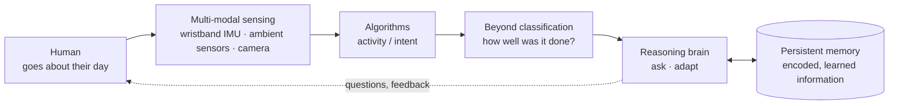

On 29 September, Dr. Sreenivasan Ramasamy Ramamurthy (Bowie State University) closed our September seminars with **"Toward Human-Centered Intelligent Systems: From Sensing to Collaborative Autonomy."** The other two talks this month were about making big models cheaper ([routing](/blog/2026/10/26/routing-in-modern-ai-systems/)) and big machines faster ([Realm](/blog/2026/10/26/realm-explicit-task-runtime/)). This one was about data from people that most machine-learning papers never reach: older adults with dementia symptoms, in their own homes, wearing a wristband.

Its central idea is one I keep coming back to. **When the activity is misclassified but the person's health status is classified correctly, the miss itself tracks cognitive impairment.** Errors, normally something to minimise, become a biomarker.

## The system he is building toward

Ramamurthy's opening scenario was a robot in an older adult's home. It watches the person go about the day, looks at gait and posture without asking them to "walk again for me" (which makes people correct themselves and spoils the measurement), and pulls the wristband's data when something looks off. Then it *asks*, at a level of severity that matches what it sensed: "Are you okay?", then "Would you like me to check in with someone?", and only then an alert to a caregiver.

He then built up what such a system needs, one box at a time:

A pipeline that stops at a prediction is a one-way street, and adding feedback to the human still doesn't make it adaptive. His point was that the *brain and memory* loop is what makes the system intelligent, and that all of it has to run within the resource budget of an edge device. The talk was in two parts: the sensing-to-beyond-classification path, then the brain.

Why older adults: his slide cited an AARP survey finding that **75% of U.S. adults aged 50 and over want to remain in their current home as they age**. He also told a story from his own data collection. A participant fell while not wearing the alert button they had been given, and lay on the floor for hours until a routine check-in.

## The data, and why it is hard

- **Cohort:** 25 adults over 65, all showing symptoms associated with neurodegenerative disorders, recorded in their own homes.
- **Sensors:** an Empatica E4 research wristband (accelerometer, gyroscope, magnetometer, skin temperature, electrodermal activity), plus ambient reed switches, PIR sensors and sensor tags.
- **Clinical scales:** a social worker administered SLUMS (dementia screening), Barthel (functional performance of daily activities) and Lawton IADL (instrumental activities).
- **Ground truth:** cameras, but the IRB allowed only **four hours of video per participant**. Each participant wore the wristband for 24 hours, so about twenty of those hours have no labels.

Three things make this hard:

1. **Simple and complex activities overlap.** Walking or jogging produce a periodic accelerometer signal with consistent power over time. Doing laundry is a sequence of sub-activities: walk to the basket, bend, carry, walk to the machine, load. Because it *contains* walking, it gets misread as walking.
2. **Classes are lopsided.** People walk many times a day and brush their hair once, and you can't ask anyone to brush their hair for twenty minutes to balance the classes.
3. **Separability collapses as classes grow.** His t-SNE plots of the raw input showed four activities forming visible clusters, eight overlapping heavily, and fourteen collapsing into a single blob.

## Method 1 · Self-taught learning

The first method uses the twenty unlabelled hours. A **deep belief network** is a stack of restricted Boltzmann machines (RBMs). Each RBM models visible units $$\mathbf v$$ (wavelet features of the accelerometer stream) and hidden units $$\mathbf h$$ with the energy

$$
E(\mathbf v, \mathbf h) = -\mathbf a^{\top}\mathbf v - \mathbf b^{\top}\mathbf h - \mathbf v^{\top} W \mathbf h,
\qquad p(\mathbf v, \mathbf h) \propto e^{-E(\mathbf v, \mathbf h)} .
$$

The layers are pre-trained greedily, one at a time, on unlabelled data. The aim is to strip noise and keep the core movement patterns. The network is then fine-tuned on the four labelled hours. In the learned representation, similar instances cluster, and the labelled examples fall into those clusters.

**Weighted F1 rose from 54% to 86%.** He reported weighted F1 because of the class imbalance above.

## Method 2 · Contrastive multitask learning, and the impairment indicator

Layer-wise pre-training is slow, so the second method skips it and uses only labelled data. A shared encoder on accelerometer windows feeds two heads:

- a **primary task (PT)** head that predicts the activity;
- an **auxiliary task (AT)** head that predicts health status. In one setup this is normal cognition, mild cognitive impairment (MCI) or dementia; in another it is activity-performance scores.

Each head has its own cross-entropy loss. A contrastive term on randomly paired samples uses only whether the two samples are in the same class. It pulls same-class pairs together and pushes different-class pairs apart, with a margin $$m$$:

$$
\mathcal L = \mathcal L_{\text{CE}}^{\text{PT}} + \mathcal L_{\text{CE}}^{\text{AT}} + \lambda\,\Big[\, y_{ij}\, d_{ij}^2 + (1-y_{ij})\,\max(0,\, m - d_{ij})^2 \Big],
\qquad d_{ij} = \lVert f(\mathbf x_i) - f(\mathbf x_j)\rVert .
$$

(The talk described the pull–push behaviour; the margin form above is the standard way to write it, not necessarily his exact loss.) He described his group as among the first to apply contrastive multitask learning to wearable sensing.

Now the key move. The network is trained to detect activities well, so **when it gets an activity wrong while still getting the health label right, the error is attributed to how the activity was performed.** For an activity class $$c$$ with $$M$$ instances:

$$
\zeta_c = \frac{100}{M} \sum_{m=1}^{M} \delta\!\left[y^{\text{PT}}_m \neq \hat y^{\text{PT}}_m\right]\cdot\delta\!\left[y^{\text{AT}}_m = \hat y^{\text{AT}}_m\right].
$$

The first factor is a missed detection on the primary task; the second is a correct detection on the auxiliary task.

| Group | Impairment indicator ζ |
|---|---|
| Normal cognition | ≈ 0% |
| Mild cognitive impairment | **10–23%** |
| Dementia | ≈ 0–2% |

The signal is strongest for MCI, the stage where early detection matters most. His explanation came from the fieldwork. Participants with MCI, asked to make a sandwich, would open the fridge, take out honey, get distracted and wander off task. Their activities really were *performed* differently, and the classifier tripped on exactly those. In the functional-impairment scenario, people who were more dependent on help (lower Barthel scores) also had more missed detections.

Why is dementia near zero rather than highest? The formula requires the *health* label to be right. One reading is that for participants with dementia, the activity head and the health head fail together, so the product term rarely fires. You can explore that below. Each cell is one instance of an activity class; click a cell to cycle its (activity, health) correctness. The presets are synthetic, chosen to show the three regimes, not the study's data.

<figure class="figure-wide">

  

    preset
    <button type="button" data-preset="NOR" aria-pressed="false">mostly correct (NOR-like)</button>
    <button type="button" data-preset="MCI" aria-pressed="true">activity misses, health right (MCI-like)</button>
    <button type="button" data-preset="DEM" aria-pressed="false">both heads struggle (DEM-like)</button>
  

  

  
each cell: activity ✓/✗ then health ✓/✗<i style="background:var(--accent)"></i>counts toward ζ (activity ✗, health ✓)

  

<figcaption>Interactive: the impairment indicator for one activity class with M = 48 instances. Only misses where the health label is still right count, so ζ is not just an error rate.</figcaption>
</figure>

## Part 2 · A brain that runs on a Jetson

The second half asked whether **small vision-language models**, running on a robot, can understand someone doing a manipulation task. Can they narrate it ("what have I done so far?"), detect mistakes ("did I miss a step?") and give corrective instructions ("how do I do this?")? The test bed was the HoloAssist dataset. The models were small VLMs (SmolVLM, LLaVA-Interleave 500M, Qwen2-VL 2B, LLaVA-1.5 and LLaVA-NeXT 7B) on Jetson Orin boards, compared along two axes:

- **Input:** a sequence of individual 224×224 frames, or one 448×448 **contact sheet** tiling the frames.
- **Prompting:** three **decomposed** calls (narration, mistake detection, instruction generation), or one **combined** prompt.

The findings, on his slide:

- **Contact sheets were 1.4–9.4× faster and used up to 9× less energy per video**, with *no loss* in narration similarity or instruction quality compared with individual frames.
- **Combined prompts were 2.3–4× faster but could not produce good corrective instructions.** Decomposed prompts could.
- Even the heaviest model, LLaVA-1.5 7B, fit in about **20 GB** on an AGX Orin, so the approach is deployable.
- **No small model could reliably detect mistakes yet.** In cluttered scenes they ramble. His favourite failure case answered a question about the user's error by restating the task instructions back.

The demo clip was memorable. A student starts brewing coffee without a cup on the tray, and the robot, running LLaVA-Interleave with a contact sheet and decomposed prompts, says out loud: *"place the cup on the tray before brewing."*

### RoboSViM v2: distil, then remember

The fix in progress is twofold. First, **knowledge distillation**: a 326-million-parameter video encoder (the teacher) is distilled into a small student by matching output distributions,

$$
\mathcal L_{\text{KD}} = \tau^2\,\mathrm{KL}\!\left(\operatorname{softmax}(\mathbf z_T/\tau)\,\big\|\,\operatorname{softmax}(\mathbf z_S/\tau)\right).
$$

Second, a **knowledge graph** acts as memory. The student's noun and verb predictions per two-second clip go into the graph, which keeps the ones that repeat across clips.

- **The student holds up.** It improves on the HoloAssist baseline by 10.5% in action accuracy and 5.5% in object accuracy, and stays within 1.7% and 3.2% of the teacher at a fraction of the size.
- **The graph is what moves the needle.** With a graph built from the model's own predictions, correctly named moments rise from 12% to 56% for actions and from 19% to 47% for objects. A graph built from correct labels recovers 100%, so the remaining gap sits in the student's perception rather than in the graph.

*A note on the numbers:* the slide labels the graph gains "+44%" and "+38%". The bars themselves give +44 and **+28** percentage points, and my redraw shows the bars.

## Where it goes next

The future-directions slides had three threads:

- **Fewer sensors, fuller picture.** Clinicians look across gait, sleep, speech, hand movements and daily activity. How much of that can one wristband plus one camera capture?
- **Adaptive human–machine teaming.** Decide when to intervene and how to escalate, and adapt the assistance to the person's skill and workload.
- **Heterogeneous machine collaboration.** Robots, drones and IoT devices share partial views, so which device senses, which reasons, and when does a problem escalate from the edge to HPC?

## What I'm taking away

1. **Read the classifier, not just its accuracy.** The impairment indicator is a new way to read a model: a *structured* error, conditioned on another head being right, becomes a measurement. The same pattern shows up in verification work. When a trace is rejected by the activity model but accepted by the context model, the disagreement is the information.
2. **Real deployment data is the contribution.** Few labels, lopsided classes, activities that blur together and an IRB cap on video are what the problem actually looks like. Most activity-recognition papers use healthy volunteers in a lab and never see any of it.
3. **Be careful with the claim.** These are 25 participants, and ζ ranges are reported per group, so the result is a promising digital-biomarker *signal*, not a diagnostic test. The talk framed it that way too.

**References and context**
- HoloAssist: an egocentric human–AI assistance dataset (Microsoft, ICCV 2023).
- SLUMS (Saint Louis University Mental Status) examination; Barthel Index; Lawton Instrumental Activities of Daily Living scale.
- Hinton, Osindero & Teh, *A Fast Learning Algorithm for Deep Belief Nets* (2006), for the DBN pre-training.

*Charts are rebuilt from the talk's slides (slides 20, 29, 35 and 43). Values on slide 20 were read off a chart and are approximate; the rest are printed on the slides.*

