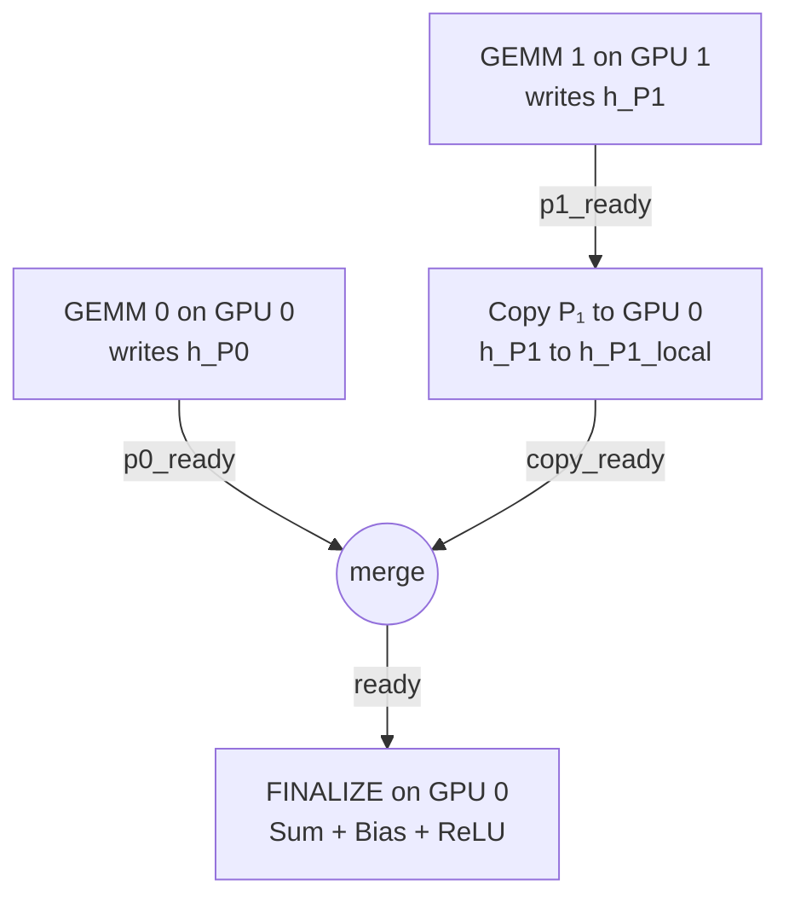

**Dr. Wei Wu, NVIDIA.** Presented as "Realm: An Explicit Task-Based Runtime — Programming and Execution on NVIDIA Hardware" at the Texas Tech University Computer Science Graduate Seminar (CS 5120), 22 September 2026.

## Abstract

Realm is a runtime system for large-scale distributed computers, begun as a research project at Los Alamos National Laboratory and now a product at NVIDIA. It is a distributed task-based runtime whose client describes dependencies explicitly with events instead of having the runtime infer them from data accesses. We present Realm's five components (tasks, events, the machine model, the data model and the DMA engine) by following one tensor linear layer, split into two independent matrix multiplications, from task definition through placement on NVIDIA GPUs and data transfer to final submission. The resulting program has no global barrier, and data movement can overlap with computation. We then show how cuPyNumeric, a NumPy-compatible distributed array library, turns array operations into Realm tasks, copies and events, and report published weak scaling of a Richardson–Lucy microscopy reconstruction to 1,024 GPUs.

*This article is a journal-style write-up of the seminar as delivered. Its content, claims and results are the presenter's; the wording is an adaptation of the recorded talk and slides.*

## 1. Introduction

A task-based runtime manages the execution of units of work: it tracks when each unit is ready and schedules ready work on execution resources such as CPUs and GPUs. We introduce the task-based model with a simple tensor computation and use the same computation to explain each Realm component and how it takes advantage of NVIDIA hardware.

## 2. Background

### 2.1 Realm at Los Alamos and NVIDIA

Realm originated in Stanford's Legion research project [1, 2]. Wu received his Ph.D. in Computer Science from the University of Tennessee in 2017 and was a research scientist at Los Alamos National Laboratory (LANL) from 2017 to 2022, where he worked on Realm while it was a research project carried out in cooperation with NVIDIA and Stanford. When NVIDIA decided to build a product on Realm, he joined NVIDIA in 2022 as a Senior System Software Engineer; since this year he also works on the CUDA user mode driver.

### 2.2 A Running Example: A Tensor Linear Layer

The example is a linear layer followed by a ReLU activation, with two-dimensional tensors:

$$
Y = \operatorname{ReLU}(XW + b), \qquad X\,[B, K],\quad W\,[K, N],\quad Y\,[B, N].
$$

$$X$$ holds a batch of input features, $$W$$ the weights and $$b$$ the bias. To expose parallel work, the shared $$K$$ dimension is split in two: $$X$$ into column groups $$X_0, X_1$$ and $$W$$ into matching row groups $$W_0, W_1$$. Then

$$
P_0 = X_0W_0, \qquad P_1 = X_1W_1, \qquad Y = \operatorname{ReLU}(P_0 + P_1 + b),
$$

which gives the same result as the original equation. $$P_0$$ and $$P_1$$ can be computed independently; $$Y$$ must wait for both.

### 2.3 Task-Based Runtime: Work and Dependencies

The example has three tasks: two matrix multiplications (GEMMs) running the same computation on different data, and a final task that sums the partial results and applies the bias and ReLU. The final task needs both partial results; the GEMMs are independent and can run concurrently when resources are available. The graph does not yet say where tasks run or how a remote result arrives.

### 2.4 Two Ways to Specify Task Dependencies

With *implicit* dependencies, the runtime derives edges from declared data use. In OpenMP [5], a producer and a consumer declare an output and an input on the same storage, and OpenMP matches them:

```cpp
#pragma omp task depend(out: partial)
gemm();

#pragma omp task depend(in: partial)
consume_partial();
```

With *explicit* dependencies, the client supplies edges through completion events. Spawning the GEMM returns `ready`, which the consumer takes as its precondition:

```cpp
Event ready = gpu0.spawn(GEMM, &a, sizeof(a));
Event done  = gpu0.spawn(CONSUME_PARTIAL, &b, sizeof(b), ready);
```

In Realm we use the explicit model. It is useful when the application, a compiler or a higher-level runtime already knows the required ordering: the ordering is passed to Realm as events, and Realm provides the execution mechanisms across the machine. Realm can therefore serve as the low-level runtime beneath higher-level runtimes, which is how it is used in NVIDIA products.

## 3. System Design

### 3.1 Realm and Its Five Components

Realm has five main components, each answering one question about the example (Table 1). The client supplies ordering and placement; Realm provides the execution mechanisms.

| Component | Question in the tensor example | Realm concept |
|---|---|---|
| Task | What computes each partial result? | A registered task |
| Event | When can the output task run? | Preconditions and completion |
| Machine model | Where can work and data go? | Resources and affinities |
| Data | How is tensor $$X$$ represented? | Points, fields, instances |
| DMA engine | How does $$P_1$$ reach its consumer? | Copies and path planning |

*Table 1. Reproduced from the presenter's slide "Realm and Its Five Components".*

### 3.2 Tasks

A task runs registered code on a selected processor; it is launched with a precondition and returns a completion event. GEMM 0 reads $$X_0$$ and $$W_0$$ and writes $$P_0$$:

```cpp
Event done = gpu0.spawn(GEMM, &args, sizeof(args), ready);
```

The arguments identify the input portions, dimensions, layout and output storage; `gpu0` is the selected processor, `ready` the precondition and `done` the completion. Task granularity is the application's choice: with four GPUs the work could be divided into four GEMMs instead of two.

A task can have implementations for different kinds of processors. The CPU version of the GEMM can call Intel MKL [6] and the CUDA version cuBLAS or cuBLASLt [7]; the client selects a compatible processor and registers the matching implementation. On NVIDIA GPUs the library determines the kernel and numerical choices, and Tensor Core use depends on the GEMM algorithm, data type, layout and hardware. Realm coordinates the tasks, dependencies and placement around that operation. Because library calls enqueue GPU work asynchronously, a CPU function returning and the GPU finishing its work are distinct moments, and completion must be carried through to the consuming work.

### 3.3 Events

Suppose $$P_0$$ is computed on GPU 0, $$P_1$$ on GPU 1, and the final task runs on GPU 0. It needs $$P_0$$ and a usable copy of $$P_1$$ there. Merging events expresses both conditions, and the merged event is the final task's precondition:

```cpp
Event ready = Event::merge_events(p0_ready, p1_local_ready);
Event done  = gpu0.spawn(FINALIZE, &args, sizeof(args), ready);
```

When both conditions hold, the task becomes eligible to run. The submitting thread does not block; it builds the dependency and continues submitting work. This is the main idea of explicit dependency programming. Realm does not derive edges from access patterns as OpenMP does, so the client must supply completion events sufficient for safe execution.

**CUDA completion releases Realm work.** A host task launches the GEMM and continues. A CUDA event recorded after the GPU work can be represented as a Realm event, so its completion can release a dependent task while the submitting host task is still running. This matters when, because of runtime overhead, one host task processes several batches rather than one; it avoids tying other execution to unrelated work and preserves the distinction between a kernel launch and its completion. We are also looking at letting a kernel signal a Realm event without exiting, which could avoid kernel launch overhead; this work is at an early stage.

### 3.4 Machine Model

A *processor* represents an execution resource, a *memory* a logical storage resource, and *affinities* describe access and transfer costs. Together they form a logical topology of the machine, which the client queries to decide where to place tasks and data. Because the model is logical, a memory need not be one physical allocation, a property used for distributed data below.

In the example, GEMM 0 runs on GPU 0 and GEMM 1 on GPU 1. GPU 0 memory holds $$X_0, W_0, P_0$$, a local copy of $$P_1$$, and $$Y$$; GPU 1 memory holds $$X_1, W_1, P_1$$. Affinity describes local access; peer connectivity, physically PCIe, NVLink or NVSwitch, describes transfers between the memories. The runtime's configured modules expose these capabilities, so different systems can support different placements and transfers for the same computation. This is especially useful for ML workloads, where the cost of moving a tensor can affect where its consumer should run.

### 3.5 Data and RegionInstances

**Realm data representation.** Consider a tensor $$X$$ with 3 batch rows and 4 feature columns.

- An **index space** is the set of valid coordinates $$(b, k)$$, $$b$$ from 0 to 2 and $$k$$ from 0 to 3; the left and right column groups are $$X_0$$ and $$X_1$$.
- A **field** is the value at each coordinate, here 4 bytes interpreted as FP32. Multiple fields are supported.
- An **instance layout** maps coordinates and fields into a memory. In one possible row-major layout, $$X[2, 3] = 0.7$$ is the last of the twelve values; another layout could place the same coordinates differently.
- A **RegionInstance** is a handle to a data instance, here `h_X`. The handle can be copied, and the client uses it to access or copy the data.

**RegionInstance and physical storage.** A RegionInstance can represent the whole tensor or an individual subtensor. In the whole-tensor case, `h_X` names the logical tensor and a global memory can back it with storage across GPUs and nodes: $$X_0$$ on node 0, $$X_1$$ on node 1, joined by a multi-node NVLink fabric. The alternative is one instance per subtensor, `h_X0` and `h_X1`.

**One virtual address range across GPUs.** A global memory implementation can map the whole tensor into one contiguous virtual range: $$X_0$$'s $$M$$ elements from base $$X$$ to $$X + M$$, backed by GPU 0 memory, and $$X_1$$'s from $$X + M$$ to $$X + 2M$$, backed by GPU 1 memory. A GPU kernel uses one base pointer and ordinary indexing, and address translation selects the physical backing. CUDA virtual memory management supports this mapping with the required device access permissions, and on multi-node systems fabric memory extends it across nodes.

**One copy request for the whole tensor.** The client then submits a single `copy(h_X, h_Y)`. Realm moves each physical part to its destination using the source and destination layouts and a supported path, and signals completion of the whole transfer with one event; the client does not submit one copy per physical location.

### 3.6 DMA Engine

**Moving a partial result.** GEMM 1 produces $$P_1$$ in GPU 1 memory, and the final task consumes it on GPU 0, so the client requests a copy. The copy waits for `p1_ready`, and its completion event `p1_local_ready` means the destination data is ready. Submitting the copy returns this event immediately; returning does not mean the transfer has finished. The DMA engine performs the movement using CPU copies, host–GPU transfers, GPU peer transfers, UCX [8] and other supported channels.

**Planning the transfer path.** A copy can take a direct peer path when supported, for example over NVLink or NVSwitch, or a staged path through host memory, for example over PCIe. The DMA engine performs channel selection and a path search, compares candidates with a cost model of estimated transfer costs, and can build multi-hop paths through intermediate buffers, using the capabilities exposed by the machine model.

**Tensor transfers across nodes.** If GPU 1 is on another node, the requirement is unchanged and so is the copy request; only the route changes. Route A stays inside a multi-node NVLink domain. Route B goes through NICs and the network fabric, with GPUDirect RDMA when the configuration supports it; some configurations also stage through a host buffer. These are alternatives, not stages of one route, and they share the same copy and completion-event interface. Because the operation is always a copy from a source instance to a destination instance, the program does not change when moved to a new machine.

**Overlap with tensor compute.** Asynchronous copies let the client overlap communication with computation: the transfer of $$P_1$$ can overlap with GPU 0's computation of $$P_0$$, and the consumer waits for both. The actual overlap depends on compute and transfer resources, memory bandwidth and contention; Wu described the schedule shown as an opportunity, not a performance measurement.

### 3.7 Submitting the Tensor Computation

With processors selected, RegionInstances allocated and inputs ready, the client submits five operations:

```text
p0_ready   = spawn(GEMM0, GPU0)
p1_ready   = spawn(GEMM1, GPU1)
copy_ready = copy(h_P1, h_P1_local, after=p1_ready)
ready      = merge(p0_ready, copy_ready)
done       = spawn(FINALIZE, GPU0, after=ready)
```



*Figure 1. Execution graph of the five submissions. Redrawn from the presenter's slide 21, "Realm: Submitting the Tensor Computation".*

Submitting GEMM 0 first does not make GEMM 1 depend on it. The copy waits for GPU 1 and the DMA engine chooses how to perform it; with global memory support, or with virtual memory management on a single node, the copy may not be needed. If GPU 1 finishes first, the copy proceeds while GPU 0 is still computing $$P_0$$. In Wu's words, "there is no global barrier in the entire program, and this is the beauty of the Realm task programming model."

## 4. Application: cuPyNumeric

### 4.1 NumPy on NVIDIA GPU Clusters

Some users may instead write array expressions and let a higher-level system build the task graph. cuPyNumeric [3], a product built on the runtime, is a distributed GPU array library with a NumPy-compatible API: a program developed with NumPy on one machine scales to an NVIDIA GPU cluster by changing the import.

```python
import numpy as np        # NumPy program on one machine
import cupynumeric as np  # same program on an NVIDIA GPU cluster
```

For supported operations the array code stays the same; the stack partitions the arrays and handles communication, and applications can operate on data sets larger than GPU memory.

### 4.2 From Array Operations to Realm

Higher layers turn array operations into the tasks, copies and events Realm executes (Table 2). This reconnects the two dependency models of Section 2.4: the top-level program does not enumerate low-level dependency edges; the explicit events are generated by the higher layers.

| Layer | Responsibility |
|---|---|
| Application | Express numerical work as array operations |
| cuPyNumeric | Create tasks and declare logical data requirements |
| Legion | Derive dependencies and map work to physical resources |
| Realm | Execute tasks and copies with explicit event preconditions |

*Table 2. Reproduced from the presenter's slide "cuPyNumeric: From Array Operations to Realm".*

### 4.3 Case Study: Microscopy Reconstruction

The case study processes a 10 TB image dataset, represented as one NumPy array, with iterative Richardson–Lucy deconvolution distributed across GPUs. Each iteration predicts the blurred image (convolution), computes a correction ratio (element-wise divide), back-projects the correction (convolution) and updates the estimate (element-wise multiply). The code is plain NumPy and runs on a laptop; to run it on a DGX box or a supercomputer, the only change is replacing `import numpy as np` with `import cupynumeric as np`.

## 5. Evaluation: Published Weak Scaling to 1,024 GPUs

Figure 2 shows weak scaling of Richardson–Lucy deconvolution on a DGX SuperPOD, from an original NVIDIA figure (May 2022, p. 27) [4] that uses cuPyNumeric's historical label, cuNumeric; a single-GPU CuPy [9] point appears at 1 GPU. The vertical axis is aggregate throughput in $$10^9$$ points per second (higher is better). Weak scaling keeps work per GPU fixed while the total problem grows with the resources, asking how well the system handles a large problem on a large machine. The curve extends to 1,024 GPUs, and Wu described the scaling as "almost linear."


*Figure 2. Weak scaling of Richardson–Lucy deconvolution on a DGX SuperPOD, 1 to 1,024 GPUs. Redrawn from the presenter's slide 26 (original NVIDIA figure, May 2022, p. 27); values read off the chart and approximate.*

## 6. Discussion

Explicit events let the submitting thread continue without blocking and remove the need for global barriers. Expressing every transfer as a copy between instances lets the route change with the machine while the program stays the same, which gives a degree of program portability.

## 7. Career and Industry Perspective

Asked what it takes to get a job at NVIDIA, Wu said he is not a typical example: he moved to NVIDIA with the Realm project. He described his interview experience. NVIDIA, unlike Google or Facebook, is very focused on low-level work. He was asked to write a producer–consumer program and then a multi-threaded one with atomic or lock-free queues; he had learned these in college but had forgotten them. He understood why only after joining the CUDA team: CUDA streams and CUDA events are built on the producer–consumer model. Other questions covered caches, cache lines and basics of computer architecture and operating systems, whereas his friends at Google, Facebook and Amazon prepared mainly coding puzzles. NVIDIA interviews include algorithm questions, he said, but focus on understanding the architecture of the system.

The host noted that AI tools such as Codex write code more efficiently than his Ph.D. students and asked for advice to students. Wu answered that coding remains very important because engineers must review the code, but knowing how to code is not enough. One cannot ask Codex for an entire program; the program must be divided into stages or smaller programs, which Codex may solve. Hardware and architecture knowledge also remains necessary, because Codex is not very familiar with it.

## 8. Conclusion

Realm is a distributed task-based runtime with explicit event dependencies, on which cuPyNumeric runs NumPy programs across GPU clusters. Realm is fully open source [1]; everyone can use it and contribute to it.

## 9. Questions from the Seminar

**Communication cost.** The host asked whether Realm also takes communication cost into account. Wu confirmed that communication is handled automatically by the runtime.

**Employment and AI coding tools.** These questions and Wu's answers are reported in Section 7.

**How much control does the programmer have over GPU placement and computation?** The programmer provides each task's implementation and the dependencies between tasks, Wu answered. How tasks are scheduled, how they overlap with communication and how data is copied are controlled by the runtime, so a distributed program can be written much like a sequential one, without managing data transfers or writing multi-threaded code.

## References

1. Realm source repository. github.com/StanfordLegion/realm (shown on the presenter's closing slide).
2. Legion, Stanford's Legion research project, in which Realm originated.
3. cuPyNumeric, a distributed GPU array library with a NumPy-compatible API (historical name: cuNumeric).
4. NVIDIA, original weak-scaling figure, May 2022, p. 27 (as cited on the presenter's slide 26).
5. OpenMP, `task depend` clauses.
6. Intel MKL.
7. NVIDIA cuBLAS and cuBLASLt.
8. UCX communication framework.
9. CuPy.
