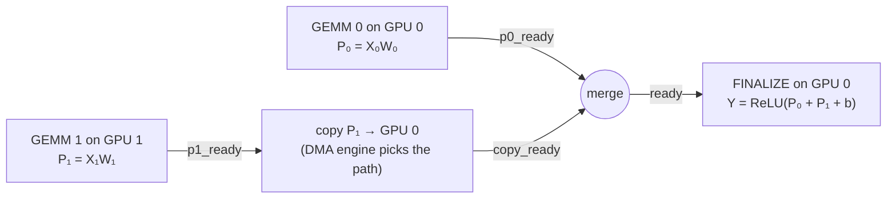

On 22 September, Dr. Wei Wu, a Senior System Software Engineer at NVIDIA, gave our graduate seminar a tour of **Realm**. Realm is the task-based runtime that sits under Legion and cuPyNumeric. It started as a research project between Stanford and Los Alamos National Laboratory, where Wu worked on it as a research scientist. NVIDIA later decided to make a product on top of it, and Wu moved with it in 2022. It is still fully open source at [github.com/StanfordLegion/realm](https://github.com/StanfordLegion/realm).

What made the talk work was that it used a single example throughout. Every component of the runtime was introduced as the answer to one question about the same small computation. I'll follow the same structure.

## The running example

Take a linear layer followed by a ReLU:

$$
Y = \operatorname{ReLU}(XW + b), \qquad X \in \mathbb R^{B\times K},\; W \in \mathbb R^{K\times N}.
$$

To expose parallel work, split the shared dimension $$K$$ in two. $$X$$ becomes two column blocks and $$W$$ two matching row blocks:

$$
X = \begin{bmatrix} X_0 & X_1 \end{bmatrix},\quad
W = \begin{bmatrix} W_0 \\ W_1 \end{bmatrix}
\;\Longrightarrow\;
XW = \underbrace{X_0W_0}_{P_0} + \underbrace{X_1W_1}_{P_1},
\qquad Y = \operatorname{ReLU}(P_0 + P_1 + b).
$$

That gives three tasks: GEMM 0, GEMM 1, and a final sum + bias + ReLU. The two GEMMs don't depend on each other, so they can run concurrently. The final task needs both partial results. Everything else in the talk is about **who says that**, **where each piece runs**, and **how $$P_1$$ gets to wherever the final task runs**.

## Who describes the dependencies?

There are two options:

- **Implicit.** In an OpenMP task program, each task declares what it reads and writes, and the runtime *infers* the edges by matching declarations on the same storage: `#pragma omp task depend(out: partial)` for the producer, `depend(in: partial)` for the consumer.
- **Explicit.** Realm makes the client supply the edges directly. Launching a task returns a completion event, and the consumer is launched with that event as its precondition.

```cpp
Event ready = gpu0.spawn(GEMM, &args, sizeof(args));           // returns a completion event
Event done  = gpu0.spawn(CONSUME_PARTIAL, &b, sizeof(b), ready); // precondition = ready
```

The explicit model suits a *low-level* runtime, whose clients are compilers and higher-level runtimes that already know the ordering. Legion analyses data accesses and then hands Realm explicit events. Realm doesn't second-guess them; it supplies the mechanism to execute them anywhere on the machine.

## Five components, one question each

| Component | Question in the tensor example | Realm concept |
|---|---|---|
| **Task** | What computes each partial result? | a registered function, launched on a processor |
| **Event** | When can the output task run? | preconditions and completion events |
| **Machine model** | Where can work and data go? | processors, memories, affinities |
| **Data** | How is $$X$$ represented? | index spaces, fields, instances |
| **DMA engine** | How does $$P_1$$ reach its consumer? | copies and path planning |

**Tasks.** A task runs registered code on a chosen processor. It takes a precondition event and returns a completion event. The same task can have several implementations: the CPU version calls MKL and the CUDA version calls cuBLAS. The client picks a compatible processor and the matching implementation. Task granularity is up to the application. Two GEMMs suit two GPUs; four GPUs would suggest four.

**Events.** The final task needs $$P_0$$ ready *and* a local copy of $$P_1$$. Realm expresses "both" by merging events:

```cpp
Event ready = Event::merge_events(p0_ready, p1_local_ready);
Event done  = gpu0.spawn(FINALIZE, &args, sizeof(args), ready);
```

Nothing blocks here. The host builds the graph and keeps submitting work, and the runtime walks the graph as preconditions fire. **There is no global barrier anywhere in the program**, and Wu called that "the beauty of the Realm task programming model."

**CUDA interoperability.** A host function returning and a GPU finishing the work it submitted are two different moments, and a correct integration has to carry the second one forward. Realm records a CUDA event after the kernel is enqueued and wraps it as a Realm event. Dependent work becomes eligible the moment the GPU finishes, not when the host task that launched it returns. Wu mentioned ongoing work to let the kernel itself signal a Realm event without returning to the host, which matters now that persistent "megakernels" are common.

## Where does everything go? The machine model

Realm exposes a **logical** graph:

- **Processors** are execution resources.
- **Memories** are storage resources.
- **Affinities** describe access and transfer costs between them.

The client queries this graph to put GEMM 0 on GPU 0 next to $$X_0, W_0$$ and GEMM 1 on GPU 1 next to $$X_1, W_1$$. On NVIDIA hardware, the edges might be PCIe, NVLink or an NVSwitch fabric. Because the model is logical rather than physical, the same program runs unchanged on a machine with a different interconnect.

## How is a tensor represented?

This was the part of the talk I found most elegant. A Realm data object is built from three separate things:

1. An **index space**: the set of valid coordinates, here all $$(b, k)$$ with $$0\le b<3$$ and $$0\le k<4$$.
2. A **field**: what lives at each coordinate, here 4 bytes interpreted as FP32.
3. A **layout**: the map from coordinates and fields to addresses in a memory. One choice is row-major:

$$
\operatorname{addr}(b,k) = \text{base} + (b\cdot K + k)\cdot 4\ \text{bytes},
\qquad X[2,3] \mapsto \text{base} + 44 .
$$

Bundle the three into a **RegionInstance** and you have a copyable handle, `h_X`, that names the data wherever it lives. Changing the layout changes nothing about the program. That separation is what lets the next trick work.

**One virtual address range across GPUs.** With a global-memory backend, an instance can represent the *whole* tensor even though $$X_0$$ physically sits in GPU 0's memory and $$X_1$$ in GPU 1's. Within a node, this uses CUDA virtual memory management; across nodes, it uses fabric memory over multi-node NVLink. The two physical pieces are mapped back-to-back into one contiguous virtual range. A kernel gets one base pointer and ordinary indexing, and the address translation picks the physical backing. **One copy request moves the whole distributed tensor, and one completion event says it has arrived.**

## How does $$P_1$$ get to GPU 0? The DMA engine

`copy()` returns an event immediately. Returning doesn't mean the transfer is done; the event fires later. Behind the call, Realm's DMA engine plans the route. It searches over the channels the machine model exposes, scores them with a cost model, and can build multi-hop paths through intermediate buffers:

- **Within a node:** a direct peer transfer over NVLink when supported, or a staged path through host memory.
- **Across nodes:** multi-node NVLink inside an NVLink domain, or a NIC path with GPUDirect RDMA when the hardware and software allow it.

The program doesn't change in either case. It is still one copy from a source instance to a destination instance.

The payoff is **overlap**. If GEMM 1 finishes first, the copy of $$P_1$$ can run while GPU 0 is still computing $$P_0$$. The animation below compares the two scheduling models on our example. Assume GEMM durations $$g_0, g_1$$, copy time $$c$$ and finalisation time $$f$$, and ignore launch overhead. Then:

$$
T_{\text{events}} = \max\big(g_0,\; g_1 + c\big) + f
\qquad\text{vs.}\qquad
T_{\text{barrier}} = \max\big(g_0, g_1\big) + c + f .
$$

The explicit-event schedule saves $$\min(c,\; g_0 - g_1)$$ whenever GEMM 0 is the longer one. That is exactly the communication that gets hidden.

<figure class="figure-wide">
<div id="realm-schedule" class="widget">
  <div class="widget__row">
    <span class="widget__mono">dependencies</span>
    <button type="button" data-mode="events" aria-pressed="true">explicit events</button>
    <button type="button" data-mode="bsp" aria-pressed="false">global barriers</button>
    <span class="widget__mono">P₁ path</span>
    <button type="button" data-path="nvlink" aria-pressed="true">peer (NVLink)</button>
    <button type="button" data-path="host" aria-pressed="false">staged via host</button>
    <button type="button" class="rm-replay">replay</button>
  </div>
  <div class="widget__row">
    <label class="widget__mono">GEMM 0 <input type="range" class="rm-g0" min="2" max="10" value="6"></label>
    <label class="widget__mono">GEMM 1 <input type="range" class="rm-g1" min="2" max="10" value="4"></label>
  </div>
  <svg role="img" aria-label="Gantt chart of the linear-layer schedule"></svg>
  <div class="widget__legend"><span><i style="background:var(--code-fn)"></i>GEMM</span><span><i style="background:var(--warn)"></i>copy (DMA)</span><span><i style="background:var(--accent)"></i>sum + bias + ReLU</span><span><i style="background:var(--rule)"></i>host blocked</span><span>● merged event fires · dashed line = barrier</span></div>
  <p class="widget__note rm-out" aria-live="polite"></p>
</div>
<figcaption>Interactive: the same five operations under explicit events and under bulk-synchronous barriers. Durations are in arbitrary units. Wu's own caveat applies: "the bar is just an opportunity, not a necessary performance measurement." Real overlap depends on bandwidth and contention.</figcaption>
</figure>

Put together, the whole computation is five submissions and a graph:



## cuPyNumeric: the same machinery under NumPy

Nobody wants to write that graph by hand for a real application, and the higher layers exist so nobody has to. **cuPyNumeric** is a NumPy-compatible distributed array library.

- **Application layer:** expresses numerical work as array operations.
- **cuPyNumeric:** turns those into tasks and data requirements.
- **Legion:** derives the dependencies and maps the work.
- **Realm:** executes the tasks and copies with explicit preconditions.

This closes the loop on the implicit-versus-explicit question from the start. The *user* writes implicit-dependency code (plain array expressions), and the *stack* generates explicit events underneath.

Wu's case study was a 10 TB microscopy reconstruction using iterative Richardson–Lucy deconvolution. The migration was changing `import numpy as np` to `import cupynumeric as np`.


Weak scaling keeps the work per GPU fixed and grows the problem with the machine. Wu described the curve as scaling "almost linearly". Reading values off the slide (approximately; the original is NVIDIA's 2022 figure), the picture is more specific:

- **Above 64 GPUs:** throughput grows about 14× for a 16× increase in GPUs, which is nearly linear.
- **8 → 32 GPUs:** the curve bends first, where cross-node communication starts to appear. Parallel efficiency, relative to linear extrapolation from 8 GPUs, settles around 45–55%.

The dotted line in my redraw makes that visible. That is still a very good result for unmodified NumPy code at 1,024 GPUs.

## Career notes

The last part of the session was about working at NVIDIA, and it was refreshingly specific. Wu's first NVIDIA interview asked him to write a **producer–consumer queue**, then a multi-threaded one, atomic or lock-free. He'd forgotten how. He only understood why they asked after joining the CUDA team: **CUDA streams and events are a producer–consumer system.** The other questions were about caches and cache lines, operating systems and architecture, not LeetCode puzzles.

On AI coding tools, his view was that they can implement a well-scoped piece but can't yet decompose a system or reason about hardware. "You cannot just tell Codex, 'write me a CUDA stream.'" Dr. Wang's wrap-up added the systems view. On large machines, moving data between GPUs costs far more than the arithmetic, so hiding communication behind compute is where the performance comes from.

## What I'm taking away

1. **Separate what from when and where.** Realm's whole design is three separations: task code from dependencies (events), dependencies from placement (machine model), and logical data from physical storage (RegionInstances). Each one lets a different layer of the stack make a decision without knowing about the others.
2. **Explicit events are a trace language.** This is the connection to my own research. A Realm program is a partial order of operations joined by events. That is a *Mazurkiewicz trace*: every interleaving the runtime may choose is an equivalent execution. Checking an agent's or a runtime's behaviour then becomes checking that the observed trace belongs to the right language. Explicit dependencies make that language easy to write down; inferred ones don't.
3. **No barrier is the feature.** Most of the speed-up in the animation above comes from what the program *doesn't* say. It never says "wait for everyone"; it says "start when your inputs exist."

**References**
- Realm source and documentation: [github.com/StanfordLegion/realm](https://github.com/StanfordLegion/realm); Legion: [legion.stanford.edu](https://legion.stanford.edu/).
- cuPyNumeric: [github.com/nv-legate/cupynumeric](https://github.com/nv-legate/cupynumeric).
- Treichler et al., *Realm: An Event-Based Low-Level Runtime for Distributed Memory Architectures*, PACT 2014.

*The weak-scaling values were read off a log-scale slide and are approximate. The schedule animation is a teaching model, not a measurement.*

<script defer src="{{ '/assets/js/seminar-widgets.js' | relative_url }}"></script>
