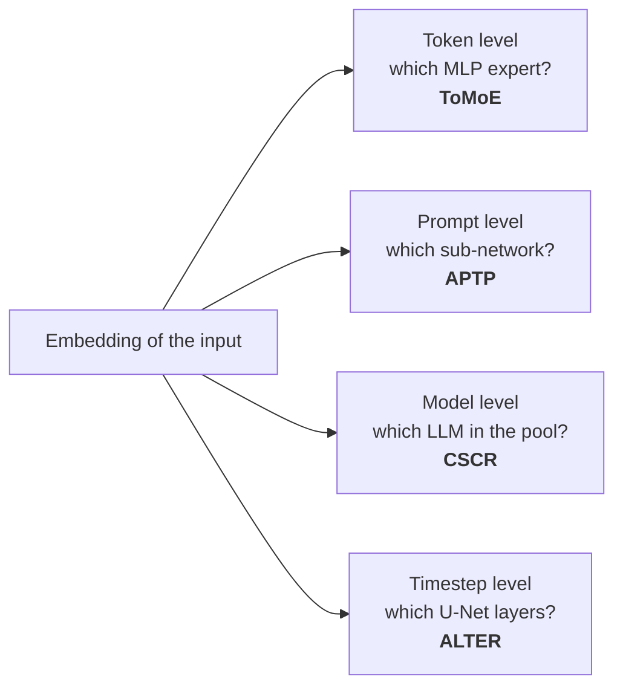

On 15 September, Dr. Shangqian Gao (Florida State University, formerly Samsung Research America) spoke to our graduate seminar on **"Routing in Modern AI Systems: A Multi-Level Perspective Across Language and Vision Models."** The title undersells the idea. Most of us meet routing as the gate inside a mixture-of-experts layer that picks an expert for each token. Gao's argument is broader. **Once an input has a good embedding, that embedding can decide how much of a model, or which model, the input actually needs.** That holds whether the input is a token, a prompt, or a diffusion timestep. Efficiency stops being a one-time decision to make the model smaller and becomes a per-input decision.

This post walks through the talk level by level. I've rebuilt the charts from the numbers on his slides; where I read values off a chart rather than a table, the caption says so. I've also added a small interactive router at the end of the model-routing section.

## Embeddings are the router's input

The talk opened with a refresher that turns out to be the foundation for everything after it. An embedding maps a raw input to a vector where distance means something. Word2vec's classic analogy is the arithmetic

$$
\mathbf v_{\text{king}} - \mathbf v_{\text{man}} + \mathbf v_{\text{woman}} \approx \mathbf v_{\text{queen}}.
$$

Sentence-BERT lifts the same idea from words to sentences. It is trained so that similar sentences land close together and unrelated ones are pushed apart. The Qwen3 embedding and reranker models go further, using a three-stage recipe: weakly supervised pretraining on large synthetic pairs, then supervised fine-tuning, then model merging.

The input doesn't even have to be language. A diffusion model's timestep gets the transformer's sinusoidal encoding:

$$
\mathrm{PE}(t, 2i) = \sin\!\left(\frac{t}{10000^{2i/d}}\right), \qquad \mathrm{PE}(t, 2i+1) = \cos\!\left(\frac{t}{10000^{2i/d}}\right).
$$

Nearby timesteps get nearby vectors. That property is what the last part of the talk exploits.

*Computed from the formula above (d = 128). Low dimensions oscillate fast, high dimensions slowly, so every timestep gets a unique, smoothly varying code.*

## Level 1 · Token routing: turning a dense model into a mixture of experts

A mixture-of-experts (MoE) layer replaces a transformer's MLP with $$N$$ smaller MLPs (the experts) and a router. For a hidden state $$\mathbf x$$:

$$
\mathbf g(\mathbf x) = \operatorname{softmax}\!\big(W_g\,\mathbf x\big), \qquad
\mathbf y = \sum_{i \,\in\, \operatorname{TopK}(\mathbf g(\mathbf x))} g_i(\mathbf x)\, E_i(\mathbf x).
$$

Only $$K$$ experts run per token, so compute scales with *active* parameters while capacity scales with *total* parameters. Gao pointed to DeepSeek-V3 and R1, which use exactly this structure. His slide cited R1 as roughly 25× cheaper than OpenAI-o1 at comparable benchmark scores. In the Q&A, asked about dense versus sparse MoE, he was blunt: at today's scale, sparse MoE "is the only design choice".

The catch is that few dense models have an MoE counterpart. Training an MoE from scratch also means custom CUDA kernels and heavy systems work. **ToMoE** ([Gao et al., arXiv 2501.15316](https://arxiv.org/abs/2501.15316)) avoids both problems by *converting* a dense checkpoint:

1. It runs data through LLaMA-3 8B (or Qwen-2.5 7B) and clusters the hidden states that feed each MLP layer.
2. Each cluster selects a matching slice of the up- and down-projection weights. That slice becomes an expert, and routing is top-1.
3. Attention heads get a mix of static and dynamic pruning.

Because the token-to-expert assignment is learned from data rather than fixed, he calls this *dynamic structural pruning*.

The comparison that matters is at matched compression. At 75% of parameters, the static methods average 43.2 (ShortGPT), 46.2 (SliceGPT) and 64.0 (ModeGPT). ToMoE at **70%** active parameters averages **66.7**, and even at 60% it still averages 62.2. The dense model is at 72.8, and none of these numbers involve fine-tuning.

His visualisations of which tokens go to which expert were honest about the limits. In early layers, the assignment looks semantically random. In the later layers, experts line up with recognisable concepts, "but this kind of observation is also not very consistent."

## Level 2a · Prompt routing: not all prompts are made equal

The second idea moves the routing signal from tokens to whole prompts. In **"Not All Prompts Are Made Equal"** (APTP, [ICLR 2025](https://iclr.cc/virtual/2025/poster/31091)), the model being compressed is a text-to-image diffusion model.

- A frozen Sentence-BERT encoder embeds the prompt.
- A small predictor maps that embedding to one of a fixed set of **architecture codes**. Each code describes a sub-network carved out of the dense model by removing blocks and pruning channels.
- A budget term keeps the *average* utilisation near a target. In his example the target was 80%.

The result is uneven by design. The largest expert keeps 99% of the model and takes the biggest share of prompts. The smallest keeps 72% and still takes about a tenth. What makes the budget work is the *weighted* average:

$$
\bar u = \sum_{i=1}^{16} \pi_i\, u_i \;\approx\; 0.80,
$$

where $$\pi_i$$ is the share of prompts sent to expert $$i$$ and $$u_i$$ is its utilisation. Hard prompts get a big sub-network and easy ones a small one. The experts also specialise without being told to. The word clouds per expert separated cleanly into themes: people and portraits, vehicles and roads, sports and teams, animals, landscapes.

## Level 2b · Model routing: the cheapest LLM that is still right

The same embedding trick works one level up, choosing *which model* in a pool should answer a query. OpenRouter is the commercial example. Gao's criticism of existing routers is specific. They are trained to be right, not to be cheap, so they over-pick large models to be safe. His slide example is a calculus question:

- A vanilla contrastive router sends it to Qwen1.5-0.5B, which is cheap but wrong.
- A baseline router sends it to LLaMA-3 8B, which is right but expensive.
- The cost-aware router sends it to DeepSeek-Math-7B, which is right *and* smaller.

**Cost-Aware Contrastive Routing** (CSCR, [Shirkavand et al., NeurIPS 2025](https://arxiv.org/abs/2508.12491)) makes this work with two pieces.

**A shared space for open and closed models.** Every LLM becomes a vector of the same dimension $$k$$:

$$
\mathbf f^{\text{white-box}}_m = \frac{1}{n}\sum_{j=1}^{n} \operatorname{softmax}\big(\mathbf z_m(q_j)\big)_{[v_1,\dots,v_k]},
\qquad
\mathbf f^{\text{black-box}}_m = \operatorname{normalise}\Big(\big[\operatorname{PPL}_{\text{GPT-2}}(o_m(q_j))\big]_{j=1}^{k}\Big).
$$

For a model whose logits we can read, it accumulates output probabilities at $$k$$ chosen vocabulary positions over $$n$$ probe queries. For an API-only model, it uses GPT-2's perplexity on that model's outputs for $$k$$ probe queries. Setting $$n = k$$ puts both kinds in one space.

**A tiny router trained contrastively against cost.** A 22-million-parameter all-MiniLM encoder embeds the query. Training pulls the query toward the fingerprints of models that answer it correctly and cheaply. At inference, the router scores the query against each fingerprint and picks among the best matches by cost. In the Q&A, someone asked whether adding a new model means retraining the router. It doesn't: you compute the new model's fingerprint and drop it into the space.

The metric is the **area under the deferral curve** (AUDC). Sweep the router's cost threshold, plot accuracy against average cost, and integrate:

$$
\mathrm{AUDC} = \int_0^1 \mathrm{acc}\big(c\big)\, dc .
$$

CSCR has the best AUDC on all three benchmarks. The oracle column is just as informative. An oracle router that knows which model will get each query right reaches 0.960 on EmbedLLM against CSCR's 0.541. Gao pointed at that gap himself when asked whether a feedback verifier could close it. A verifier helps when the answer is checkable, for example code that compiles and passes tests. A *learned* verifier, though, "will give you additional errors."

To get a feel for the deferral curve, here is a toy version. Four synthetic models of different cost and skill answer 600 synthetic queries. One of them is a cheap specialist that is extra good at a "math" subset. The router estimates each query's difficulty with noise and calls the cheapest model whose estimated success probability clears a threshold τ. The *specialist-aware* router knows the specialist's strength (the analogue of a good model fingerprint); the *specialist-blind* one doesn't. Drag τ and watch where the operating point lands. The data is synthetic, chosen to illustrate the shape of the trade-off, not to reproduce the paper.

<figure class="figure-wide">

  
<label class="widget__mono">threshold τ <input type="range" min="0" max="100" value="55" style="width:240px"></label>

  <svg role="img" aria-label="accuracy versus cost deferral curve"></svg>
  
<i style="background:var(--accent)"></i>specialist-aware router (deferral curve)<i style="background:var(--ink-3)"></i>specialist-blind router○ single model always · ● oracle

  

<figcaption>Interactive: a deferral curve and its area. Moving right buys accuracy with cost. A better fingerprint shifts the whole curve up and to the left.</figcaption>
</figure>

## Level 3 · Temporal routing: skipping layers per denoising step

The last part applied routing along the time axis of diffusion. **ALTER** ([NeurIPS 2025, arXiv 2505.21817](https://arxiv.org/abs/2505.21817)) feeds the timestep embedding to a hypernetwork that generates a small set of experts. A *temporal router* then assigns each denoising step to one expert, and that expert says which U-Net layers to skip at that step. Two design choices make it practical:

- **It only removes whole layers.** It doesn't touch biases or prune channels, so the speed-up is real on actual hardware rather than only in FLOP counts.
- **It uses every parameter over a full sampling run.** That differs from per-prompt pruning, where a prompt only ever sees its own sub-network. Different steps simply use different subsets.

The premise is that neighbouring timesteps need similar computation. The learned assignment confirmed it: adjacent timesteps landed on the same expert without being told they were adjacent.

On CC3M, Stable Diffusion 2.1 takes 4.0 s per image at FID 17.08. ALTER at 65% utilisation and 20 steps takes **2.1 s at FID 17.14**. BK-SDM-v2 is a distilled competitor that needs retraining, and it sits at 2.5 s with FID 17.5–18.8. One detail I only noticed while rebuilding the table: the two **APTP** rows (FID 36.8 and 60.0) are Gao's own prompt-routing method from Level 2a, used here as a baseline. Per-prompt pruning tuned for quality on a small budget doesn't transfer well to a per-step latency target, and ALTER is partly the fix for that.

## What I'm taking away

Dr. Wei Wang's wrap-up framed it well. Today, ChatGPT and Gemini make *the user* choose between instant and deep thinking, and this line of research aims to have the system make that choice per input. Three things stuck with me.

1. **One mechanism, four granularities.** Token, prompt, model and timestep routing are the same move: embed the unit of work, then let a small learned function choose a sub-computation. That makes the embedding, not the router, the place where quality is won or lost.
2. **The oracle gap is the honest headline.** Every router here beats its baselines, and every router is still far from the oracle. A routing decision is a prediction about a model's future correctness, and it fails silently.
3. **This connects to verification.** My own work treats agent runs as traces to be checked against a formal language. A router is a decision point inside such a trace. It's exactly where a cheap, *checkable* signal (did the code compile? does the JSON parse?) can confirm or veto the choice, without adding the learned-verifier error Gao warned about.

**References**
- Gao et al., *ToMoE: Converting Dense Large Language Models to Mixture-of-Experts through Dynamic Structural Pruning*, [arXiv 2501.15316](https://arxiv.org/abs/2501.15316) (TMLR 2026).
- Ganjdanesh et al., *Not All Prompts Are Made Equal: Prompt-based Pruning of Text-to-Image Diffusion Models*, [ICLR 2025](https://iclr.cc/virtual/2025/poster/31091).
- Shirkavand et al., *Cost-Aware Contrastive Routing for LLMs*, [arXiv 2508.12491](https://arxiv.org/abs/2508.12491) (NeurIPS 2025).
- *ALTER: All-in-One Layer Pruning and Temporal Expert Routing for Efficient Diffusion Generation*, [arXiv 2505.21817](https://arxiv.org/abs/2505.21817) (NeurIPS 2025).
- Vaswani et al., *Attention Is All You Need* (2017), for the positional encoding.

*Charts are rebuilt from the talk's slides; slide numbers are in each caption. Any errors in reading them are mine.*

