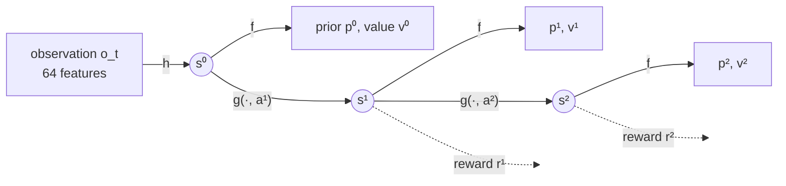
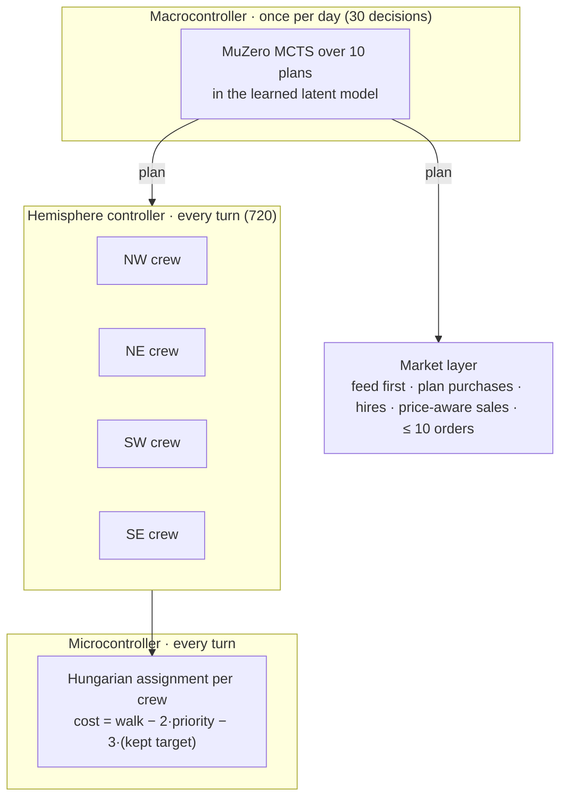

**Team 4H (Scott Weeden)** finished **2,301 of 10,148** in Kaggle's *Kaggriculture* simulation competition, with a final score of 4166.2 (top 22.7%). Most of that rating came from a community rule chassis, not from learning. This page has three parts:

1. A working agent demo.
2. A one-page explanation of MuZero as it is used here.
3. A post-mortem of why the submitted "MuZero" agents never consulted their network, and the rebuild that does.

<div class="widget" style="margin:24px 0">
<div class="widget__grid">
<div><h4>Rebuilt agent, held-out seeds</h4><p class="widget__mono"><strong>$62,031</strong> vs $36,001 against the expert playbook · 40/40 wins</p></div>
<div><h4>Weight-swap test</h4><p class="widget__mono">trained <strong>$62,031</strong> vs random weights <strong>$16,845</strong> on the same games</p></div>
</div>
<p class="widget__note">Both numbers come from a local simulator with seat-swapped pairs on fixed seeds. The Kaggle ladder had closed before this agent existed. Links: <a href="https://www.kaggle.com/code/scottweeden/kaggriculture-muzero-post-mortem">post-mortem notebook</a> · <a href="https://www.kaggle.com/datasets/scottweeden/kaggriculture-muzero-hemisphere-weights">weights + ready-to-submit main.py</a> · <a href="https://github.com/sweeden-ttu/kaggriculture_1_37_muzero">repository</a></p>
</div>

## 1 · The agent, playing

Pick a game and press play. The left farm is MuZero and the right farm is the hand-written expert playbook. Both use the same executor, so the plan each one picks is the only difference between them. Each new day, the panel under the farms re-runs MuZero's search **in your browser** from the same 64 features the agent saw. Try the random weights to see what the weight-swap test measures.



Watch the first game play out. MuZero opens with melons and wheat, moves into strawberries, buys the NE quadrant on day 12, and then adds cows and sheep. Late in the season it switches to short-cycle carrots and stops planting on day 26, when nothing new could mature before day 30. The playbook expands on a fixed schedule. Because the market is shared and price-elastic, every melon MuZero sells lowers the price the playbook gets for its own melons.

## 2 · MuZero in one page

MuZero ([Schrittwieser et al., 2020](https://www.nature.com/articles/s41586-020-03051-4)) plans with a model it learns, never with the game's rules. It learns three functions.

$$
\begin{aligned}
s^0 &= h_\theta(o_t) && \text{representation: observation} \to \text{latent state}\\
s^{k},\, r^{k} &= g_\theta\!\left(s^{k-1}, a^{k}\right) && \text{dynamics: latent state, action} \to \text{next latent state, reward}\\
\mathbf p^{k},\, v^{k} &= f_\theta\!\left(s^{k}\right) && \text{prediction: latent state} \to \text{policy, value}
\end{aligned}
$$

Here $$o_t$$ is 64 hand-built features: the day, both farms' money, land, crop counts and ages, herd sizes, our shed and seeds, and the price ratio of nine goods. Both farms are public, so the opponent is part of the state. Each function is a two-layer MLP: $$h: 64\to128\to64$$, $$g: (64+10)\to128\to64$$ plus a reward head, and $$f: 64\to128\to(10, 1)$$. The latent is min–max scaled to $$[0,1]$$ after every step, as in the paper. The whole network has **44,300 parameters**.

**The action is a plan, not a move.** Each turn, each of up to 15 units chooses from about 20 operations, and the player can also place 10 ordered market slots. Searching that space within a 1-second turn limit is hopeless. So MuZero decides **once per game day** among ten plans: plant wheat, carrot, tomato, strawberry or melon; buy land; add cows, sheep or geese; or leave the land fallow. Illegal plans are masked, including any crop that cannot mature before day 30. A season is therefore a 30-step episode.

### The search

At the root, the network's prior over legal plans seeds a tree. Each simulation walks down the tree by choosing the child that maximises the pUCT score:

$$
a^\star = \arg\max_a \; \bar Q(s,a) + P(s,a)\,\frac{\sqrt{N(s)}}{1+N(s,a)}\left(c_1 + \log\frac{N(s)+c_2+1}{c_2}\right),
\qquad c_1 = 1.25,\; c_2 = 19{,}652
$$

Here $$\bar Q$$ is the mean value of $$r + v$$, min–max normalised across the whole tree. That normalisation matters because rewards are measured in units of <span>$</span>10,000. At the leaf, the search expands one step with $$g_\theta$$ and evaluates the new state with $$f_\theta$$. It then backs the value up the path, with discount 1 because the season has a fixed length. The plan played is the most-visited child. During self-play, Dirichlet(0.3) noise is mixed into the root prior.



### The training loss

Training unrolls the model $$K = 5$$ steps from a sampled position and matches each step against what actually happened.

$$
\mathcal L(\theta) = \sum_{k=0}^{K} w_k\Big[\underbrace{-\,\boldsymbol\pi_{t+k}^{\top}\log \mathbf p^{k}}_{\text{policy}} + \tfrac12\underbrace{\big(v^{k}-z_{t+k}\big)^2}_{\text{value}} + \underbrace{\big(r^{k}-u_{t+k}\big)^2}_{\text{reward}} + \lambda\,\underbrace{\big(1-\cos(\,q(g^{k}),\, \mathrm{sg}[\,p(h(o_{t+k}))\,])\big)}_{\text{consistency}}\Big]
$$

The terms are:
- **Policy:** $$\boldsymbol\pi$$ is the search's visit distribution.
- **Value:** $$z$$ is the exact Monte-Carlo return, meaning final cash minus cash today.
- **Reward:** $$u$$ is the day's change in cash.
- **Consistency:** a SimSiam-style term, as in [EfficientZero](https://arxiv.org/abs/2111.00210). It pulls the imagined next state toward the encoding of the real one, through a stop-gradient $$\mathrm{sg}$$.

The weights are $$w_0 = 1$$ and $$w_{k>0} = 1/K$$. The gradient into each dynamics step is halved, as in the paper.

### The curriculum

| Phase | Data | Targets | Extra loss |
|---|---|---|---|
| 1 · behaviour cloning | 40 expert-playbook games | 60% on the playbook's plan, 40% spread over legal plans | |
| 2 · consistency bootstrap | same | same | consistency, $$\lambda = 1$$ |
| 3 · self-play | network vs itself, search with noise, 32 simulations | visit counts; Monte-Carlo returns | consistency, $$\lambda = 0.25$$ |
| 4 · reanalyse | stored self-play games | visit counts recomputed with the newest network | |

After every self-play iteration, a **promotion gate** plays the candidate against the playbook on 10 seat-swapped seeds. It promotes the candidate only if its mean margin beats the champion's. The champion came from iteration 17. The full run took about 28 minutes on two CPU cores.


One failure on the way is worth recording. The first run used near one-hot expert labels (90% on the expert's plan) and a small search. It produced a **perfect copy of the playbook**: all 30 plans identical and every evaluation tied. With a peaked prior and few simulations, the search can never disagree with the prior. Softer labels and 32 simulations fixed it, and the first self-play iteration then beat the playbook in 9 of 10 games.

## 3 · Below the planner: hemispheres and the Hungarian algorithm



- **Hemisphere controller.** Each unlocked 5×5 quadrant (a *hemisphere*) is treated as its own sub-farm with its own crew. The farmer and the hired hands are split between hemispheres in proportion to the priority-weighted work waiting in each. A unit stays in the hemisphere it worked last turn, so crews are stable.
- **Microcontroller.** Inside a crew, units are matched to tasks (water, harvest, feed, care, plant, build, fetch an animal) with `scipy.optimize.linear_sum_assignment`. Feeding is solved first, across the whole farm, because an animal not fed for two days escapes.
- **Market layer.** It buys feed first and keeps an operating reserve. It sells against the published price curves and stops when the next unit would sell below a floor that drops as the shed fills and the season ends.

The micro layer has no strategy of its own. Its only job is to make the plan true.

## 4 · Post-mortem: the network never reached the game


The score climbed in jumps, and the jumps came from rules, not from learning. In the first two weeks I submitted Q-PPO, DQN, Rainbow C51, PPO, CFR and a strategy meta-ensemble, and none of them passed a rating of 504. The jump to about 2,030 on 25 September came from `submission_hybrid_direct`. That was a 7,400-line rule chassis built on the community's public Apache-2.0 agents, plus my own layers distilled from top replays. Most of the rating belongs to those authors, and their notices are kept in the file.

On 29 September I traced the path from training to play and measured each step. I found five separate breaks, and any one of them would have been enough on its own:

| # | Where | What was wrong | Evidence |
|---|---|---|---|
| 1 | Agent code | The network was loaded and never called | 0 forward passes in a 720-step game, while the telemetry said `decision_maker: spatial_muzero` |
| 2 | Package submitted on 29 Sep | The call to the planner sat under `if False:` | `main.py` line 7531 |
| 3 | Checkpoint loading | The package built a network of a different shape and silently kept only the tensors that fit | 4–8 tensors left random, re-drawn on every start |
| 4 | Training → packaging | The trained network was not the one shipped | 2,094,405 parameters trained; 227,578 shipped |
| 5 | Design | Where the network *was* consulted, it could only approve a sale of at most 3 wool or milk, or veto one land purchase | With the loader fixed, random weights changed the score by a median of <span>$</span>73 on <span>$</span>87,000 |

**The lesson is not "fix the loader".** The design gave the network nothing to decide. A 7,400-line rule chassis made every farmer, hand, planting and purchase decision, so a network trained to perfection would still have moved the score by less than 0.1%. Nothing in the pipeline ever checked whether the weights mattered, so the dashboard reported a MuZero agent that did not exist.

The rebuild is designed around the one check the original never ran, the **weight-swap test**. Play the same games with the trained weights and with random weights. If the scores don't differ, the network isn't playing.


Against the playbook, the trained agent averaged <span>$</span>62,031 to <span>$</span>36,001 and won all 40 games. With random weights, the same agent averaged <span>$</span>16,845 and lost all 40. Facing that weak opponent, the playbook made <span>$</span>67,801, nearly double what it made against the trained network. That is the shared market again: the more your opponent grows, the less your crop is worth. For scale, the playbook beats random plans <span>$</span>51,810 to <span>$</span>19,622. MuZero beats random plans by a larger margin (<span>$</span>53,858 to <span>$</span>21,545). So the network learned something the hand-written expert did not have.


## 5 · What I would do differently

1. **Run the weight-swap test before trusting any learning curve.** It takes one cell, and it would have shown the problem in the first week instead of on the last day.
2. **Give the network the decisions that matter.** Choose the abstraction first, then wire it in, then train it.
3. **Make loaders strict and failures loud.** A `strict=False` load and a bare `except` turned two shape mismatches into silent random weights.
4. **Keep the best agent active.** Kaggle keeps only the newest submissions playing, so the 2,055.8 agent stopped counting when newer ones arrived. A new build should go up only next to a copy of the current best.
5. **Evaluate in seat-swapped pairs on fixed seeds.** In my runs, the same plan earned <span>$</span>71k against a weak opponent and <span>$</span>28k against an equal one.
6. **Fewer architectures, each taken further.** I submitted at least seven model families in 17 days and finished none of them.

## Reproduce it

```bash
pip install "kaggle-environments==1.33.2" numpy scipy
kaggle datasets download scottweeden/kaggriculture-muzero-hemisphere-weights --unzip
python -c "
import numpy as np, muzero as M, playbook as P
from kaggle_environments import make
net = M.NumpyMuZero(dict(np.load('muzero_weights.npz')))
env = make('kaggriculture', configuration={'episodeSteps': 720, 'seed': 90000})
env.run([M.MuZeroAgent(net, sims=32), P.PlanAgent(P.playbook_plan)])
print([s.reward for s in env.steps[-1]])   # [65684.0, 43628.0]
"
```

`submission/main.py` in the dataset is a complete single-file agent, with the weights embedded in base64. It needs only NumPy and SciPy. Its slowest turn took 237 ms on a Kaggle notebook CPU, against the 1-second limit. The search is deterministic, so a rerun prints the same numbers. The demo on this page was generated the same way, with seeds 90000 and 90001.

*Earlier design notes for this project (a LoRA/Gumbel-MCTS specification from September) are kept in this page's git history.*
