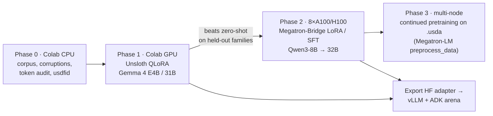

**Where this starts.** In October I published [The Archetypal Knee](https://www.kaggle.com/datasets/scottweeden/the-archetypal-knee). It is a healthy right and left knee written entirely in OpenUSD: 58 labelled anatomical structures per knee, each mesh carrying `knee:volumeMm3`, `knee:surfaceAreaMm2` and 1.5 T MRI tissue properties. Six MRI acquisitions are stored as prims, and 224 synthetic DICOM images were rendered *from the USD alone*. A companion notebook, *Knee USD Fidelity Arena*, has Gemma 4 agents built with Google ADK write the pieces of a challenge:

- **O1:** a fidelity metric with controlled corruptions.
- **O2:** source scenes from natural-language descriptions.
- **O3:** labelled pairs for a verification track.

This page turns that into a research plan. Every external claim links to its source. Where I couldn't verify something, I say so.

> **Clinical framing.** The archetype and any anomaly maps built from it are research artefacts, not diagnostic tools. The archetype is a plausible healthy knee built from procedural shapes, not population-average anatomy. For example, its femoral cartilage comes out at about 20 cm³, roughly double typical values.

## 1 · Why this is a real gap

The production USD language model today is NVIDIA's **USD Code** NIM. It is Llama-3.1-70B-Instruct plus retrieval, it writes OpenUSD *Python* rather than `.usda`, and it has no downloadable fine-tuned weights ([model card](https://docs.api.nvidia.com/nim/reference/nvidia-usdcode)). The closest open research is **IL3D** (Oct 2025), which stores 27,816 room layouts as USDA and fine-tunes Qwen3 1.7B–14B to generate them ([arXiv 2510.12095](https://arxiv.org/pdf/2510.12095)). No one has yet built a model that reads and writes `.usda`, judged by a USD-native fidelity metric, on an anatomical scene. That is a defensible gap.

## 2 · Review of the existing 3-D model (my archetype)

| | |
|---|---|
| Stage layout | `knee_archetype.usda` (master) → anatomy layer → one `.usda` per acquisition (Sagittal/Coronal/Axial × FS/non-FS) → binary `.usdc` mesh layers |
| Units and frame | millimetres, DICOM patient LPS (+X left, +Y posterior, +Z superior); right knee at x = −90 mm, left at +90 mm (exact mirror) |
| Per-mesh schema | `knee:label`, `knee:tissue`, `knee:volumeMm3`, `knee:surfaceAreaMm2`, `mri:t1Ms`, `mri:t2Ms`, `mri:protonDensity`, `mri:fatFraction`, `mri:flowVoidFraction` |
| Geometry | procedural signed-distance shapes voxelised at 0.5 mm; marching cubes on the label volume; **≈1.65 M mesh faces per knee** |
| Round trip | the synthetic DICOM were re-read by the included cataloguer, and all 12 series came back with the expected plane, fat suppression, sequence class, spacing and laterality |
| Licence | CC BY-NC 4.0 |

**What the review means for an LLM.**
- **Good:** the stage is already layered the right way. Structure, transforms and attributes live in small text layers, and geometry lives in `.usdc`. That is exactly the split a language model needs, as Section 6 shows.
- **Weak:** the anatomy is not population-average, there is one archetype rather than a distribution, and nothing yet varies the anatomy within healthy ranges. The plan therefore adds anatomical *variants* before training and holds them out at test time.

## 3 · Datasources

Converting any USD flavour to text is one command: `usdcat -o out.usda in.usdc`, with `--flatten` to bake in references and variants ([OpenUSD tutorial](https://openusd.org/release/tut_converting_between_layer_formats.html)). `pip install usd-core` gives the core libraries ([PyPI](https://pypi.org/project/usd-core/), 26.11). For non-USD formats, use [`guc`](https://github.com/pablode/guc) for glTF/GLB→USD and [Adobe's USD file-format plugins](https://github.com/adobe/USD-Fileformat-plugins) for FBX, OBJ, PLY and STL. **Licences are the binding constraint.**

| Source | Licence | Size | Use in this plan |
|---|---|---|---|
| **My archetype + generated corruptions/variants** | mine (CC BY-NC for the published data) | unbounded | **core** training and test data |
| [NVIDIA PhysicalAI-SimReady-Warehouse-01](https://huggingface.co/datasets/nvidia/PhysicalAI-SimReady-Warehouse-01) | CC-BY-4.0 | 753 USD assets | general USD fluency |
| [usd-wg/assets](https://github.com/usd-wg/assets) | Apache-2.0 repo, assets typically CC0 | small, incl. **deliberately malformed** files | externally authored repair cases |
| [Infinigen Indoors](https://www.cgchannel.com/2025/06/open-source-tool-infinigen-indoors-generates-procedural-3d-interiors/) | BSD-3 (output is yours) | procedural, exports whole scenes to USD | unlimited licence-clean scene/text pairs |
| [IL3D](https://arxiv.org/pdf/2510.12095) | *unverified* | 27,816 USDA layouts | baseline and comparison |
| [ALab](https://github.com/DigitalProductionExampleLibrary/ALab) (Animal Logic) | ASWF Digital Assets Licence (ML training not mentioned) | 300+ assets, mostly `.usda` | evaluation only until the licence is clarified |
| [Objaverse](https://huggingface.co/datasets/allenai/objaverse) / [-XL](https://huggingface.co/datasets/allenai/objaverse-xl) | ODC-By overall, **per-object** licences | 800 K / 10.8 M objects | geometry pretraining, filtered to CC-BY/CC0 |
| [OAIZIB-CM](https://huggingface.co/datasets/YongchengYAO/OAIZIB-CM) (knee MRI + 5-label masks) | CC BY-NC 4.0 | 507 MRIs | anatomical realism track: marching cubes → `UsdGeom.Mesh` |
| [TotalSegmentator v2](https://zenodo.org/records/10047292) | CC BY 4.0 (the appendicular-bones model's licence **forbids** training similar algorithms) | 1,228 CTs | femur only; avoid the restricted bones |
| [Pixar Kitchen Set](https://openusd.org/release/dl_kitchen_set.html) | personal testing only, **no redistribution** | — | private sanity check, never in a dataset |
| [SKI10](https://ski10.grand-challenge.org/Rules/) | closed | — | not usable |

## 4 · Review of existing 3-D and scene LLMs

| Model | Predicts | Representation | Weights |
|---|---|---|---|
| [NVIDIA USD Code](https://docs.api.nvidia.com/nim/reference/nvidia-usdcode) | OpenUSD Python, Q&A | Python + RAG; Llama-3.1-70B | hosted NIM only |
| [IL3D-SFT](https://arxiv.org/pdf/2510.12095) | text → room layout | **USDA**; Qwen3 1.7B/4B/14B | unverified |
| [LLaMA-Mesh](https://huggingface.co/Zhengyi/LLaMA-Mesh) | text ↔ mesh in chat | OBJ as plain text, quantised coordinates, no new tokens; Llama-3.1-8B | yes (non-commercial) |
| [SpatialLM](https://github.com/manycore-research/SpatialLM) | point cloud → walls, doors, boxes | structured text layout; 0.5–1 B | yes (CC-BY-NC) |
| [SceneScript](https://github.com/facebookresearch/scenescript) (Meta) | point cloud → layout + boxes | structured-language tokens | via project (CC BY-NC) |
| [CAD-Recode](https://github.com/filaPro/cad-recode) | point cloud → CadQuery Python | code, **execution-scored**; Qwen2-1.5B | yes |
| [Roblox Cube](https://arxiv.org/pdf/2503.15475) | text → shape, LLM scene graph | discrete shape tokens | yes |
| [LayoutGPT](https://github.com/weixi-feng/LayoutGPT), [Holodeck](https://github.com/allenai/Holodeck) | text → 3-D layout | prompted JSON/text | prompting only |

**Three takeaways:**
1. **Serialise as text, without new tokens** (LLaMA-Mesh).
2. **Execute, then score** (CAD-Recode). The USD equivalent is to open the generated stage and measure it.
3. **Compare against IL3D, with USD Code as a zero-shot baseline.**

## 5 · Autodesk

- **Standards.** Autodesk is a founding member of the [Alliance for OpenUSD](https://www.autodesk.com/solutions/media-entertainment/openusd). AOUSD released [Core Specification 1.0](https://digitalproduction.com/2026/01/05/aousd-releases-openusd-core-specification-1-0/) in January 2026. It defines the USDA grammar, composition and value resolution, which is exactly what the L0/L1 layers of the metric should be anchored to.
- **Open-source tooling.** [maya-usd](https://github.com/Autodesk/maya-usd), 3dsmax-usd, arnold-usd and the [Aurora](https://github.com/Autodesk/Aurora) Hydra path tracer. These are mainly *data-generation* tools: DCC exporters turn existing scenes into `.usda` training pairs.
- **Generative 3-D.**
  - [Project Bernini](https://develop3d.com/ai/autodesk-unveils-project-bernini-for-3d-generative-ai/) trained on about 10 M shapes and is not public.
  - Its open, non-commercial descendants [WaLa-SK-1B](https://huggingface.co/ADSKAILab/WaLa-SK-1B) and [Make-A-Shape](https://huggingface.co/ADSKAILab/Make-A-Shape-multi-view-20m) generate wavelet-encoded TSDFs.
  - **Use in this plan:** a *geometry baseline*. Generate a mesh, wrap it in USD, and score it with the same `usdfid`.
- No Autodesk USD dataset or benchmark was found.

## 6 · The tokenizer problem, measured

Before choosing a model, I counted tokens for the same eight-mesh toy knee (720 vertices) in five text forms, using each model's own tokenizer:

- **The tokenizer matters.** Llama-3 groups digits in threes; Gemma 4, Qwen3 and Mistral split every digit. Inline point arrays therefore cost **31–44 tokens per vertex** (including the face indices).
- **Scaled up.** At 44 tokens per vertex, the real archetype (≈1.65 M faces per knee) would need on the order of **tens of millions of tokens per knee** inline. That is impossible.
- **The fix.** Moving geometry into a payload reference cuts the stage to about 1,000 tokens. **The model writes structure, transforms and attributes, and references geometry.** Quantising coordinates (as LLaMA-Mesh does) helps only within a factor of two.

## 7 · `usdfid`: a layered score

A single number lets a model trade validity for geometry without anyone noticing. So every layer is reported separately, and a parse failure scores zero:

| Layer | Check | Tool |
|---|---|---|
| **L0** parse/compose | opens, composes, no unresolved references | `Sdf.Layer.ImportFromString`, `Usd.Stage.Open` |
| **L1** validity | new validation errors vs the reference | `UsdValidation` (`usdchecker`'s successor) |
| **L2** structure | prim-path Jaccard × type match × stage metadata (`upAxis`, `metersPerUnit`, `defaultPrim`) | custom |
| **L3** attributes | world-transform error, `knee:*` values with tolerances | custom (`usddiff` has no numeric tolerance) |
| **L4** geometry | Chamfer + **F-score@τ**, τ = 1% of the bounding-box diagonal ([Tatarchenko et al.](https://ar5iv.arxiv.org/html/1905.03678)) | numpy |

$$
\mathrm{usdfid} = \mathbb 1[\text{L0}]\,\big(0.15\,\text{L1} + 0.25\,\text{L2} + 0.25\,\text{L3} + 0.35\,\text{F@}\tau\big)
$$

A working prototype is in [`notebooks/usd-llm/usdlab.py`](https://github.com/sweeden-ttu/profile/blob/stable/notebooks/usd-llm/usdlab.py). On eight corruption families × 20 seeds, each family moves a *different* layer:

- **Swapping two structures' labels** costs only 0.015 overall but shows clearly in L3. For anatomy, a mislabelled cartilage is a serious error, which is why the challenge needs per-layer leaderboards.
- **A wrong `upAxis` or `metersPerUnit`** leaves structure intact but destroys geometry, because the stage is read the way it declares itself.
- **A dangling reference** shows only in L0/L1.

## 8 · Training plan: Colab prototype → Megatron at scale

**Why Megatron-Bridge.** Megatron-LM's own HF-conversion doc now points to [Megatron-Bridge](https://github.com/NVIDIA-NeMo/Megatron-Bridge) ([doc](https://raw.githubusercontent.com/NVIDIA/Megatron-LM/main/docs/llama_mistral.md)). Bridge (Apache-2.0, [PyPI](https://pypi.org/project/megatron-bridge/) 0.6.x, Python 3.12) does HF↔Megatron conversion, SFT and LoRA, and pins Megatron-Core as a submodule. My [Megatron-LM fork](https://github.com/sweeden-ttu/Megatron-LM) replaces that submodule only if I carry core patches.

**Why Qwen3 for the cluster phase.** It has the most complete set of published Bridge recipes, and it matches IL3D. The recipes:

| Recipe | TP/PP | Nodes |
|---|---|---|
| `qwen3_8b_peft_config` | 1/1 | 1 |
| `qwen3_32b_peft_config` | 1/1 + recompute | 1 |
| `qwen3_8b_sft_config` | 4/1 | 1 |
| `qwen3_32b_sft_config` | 8/2 | 2 |

Source: [Qwen3 recipes](https://docs.nvidia.com/nemo/megatron-bridge/0.5.0/apidocs/bridge/bridge.recipes.qwen.qwen3.html).

Gemma 4 stays on the HF/Unsloth/vLLM side for now. A 31B *text* SFT recipe for it was not confirmed in Bridge.

**Compute.** These are upper bounds, using $$C \approx 6ND$$ ([Kaplan et al.](https://arxiv.org/pdf/2001.08361)), 312 TFLOPS BF16 per A100, and an assumed 40% MFU:

| Run | FLOPs | A100-hours |
|---|---|---|
| E4B × 20 M tokens | 4.8 × 10¹⁷ | ≈ 1 (Colab) |
| Qwen3-8B × 1 B tokens | 4.8 × 10¹⁹ | ≈ 110 (≈ 14 h on 8×A100) |
| 32B × 1 B tokens | 1.9 × 10²⁰ | ≈ 420 (≈ 2.2 days on 8×A100) |

A realistic first corpus is 50 k stages × 5–20 k tokens, or 0.25–1 B tokens.

### The notebooks

| Notebook | Runtime | Status |
|---|---|---|
| [01 · corpus, corruptions, usdfid, token audit](https://colab.research.google.com/github/sweeden-ttu/profile/blob/stable/notebooks/usd-llm/01_usd_corpus_and_usdfid.ipynb) | CPU | **runs end-to-end** (checked with usd-core 26.11) |
| [02 · QLoRA prototype with Unsloth](https://colab.research.google.com/github/sweeden-ttu/profile/blob/stable/notebooks/usd-llm/02_usd_qlora_unsloth_colab.ipynb) | L4/A100 | scaffold; not yet run |
| [03 · Megatron-Bridge runbook](https://colab.research.google.com/github/sweeden-ttu/profile/blob/stable/notebooks/usd-llm/03_megatron_bridge_sft.ipynb) | Colab → cluster | data prep runs; training is on the cluster |

## 9 · Challenge design

1. **Repair (O1).** A corrupted knee stage in, the fixed `.usda` (or a minimal override sublayer) out. **Whole corruption families are held out** between train and test (the notebooks hold out `units` and `swap_label`), along with anatomical variants. The usd-wg malformed assets add externally authored cases.
2. **Text → stage (O2).** A healthy-baseline description in, a stage out, scored against the archetype.
3. **Anomaly localisation (O3 + imaging).** A patient-derived stage, or OAIZIB-CM meshes, in. Out: a ranked list of prim paths that deviate from the archetype (scored by mAP / top-k), and a voxel divergence map scored by Dice and AUROC against synthetic ground-truth deformations.
4. **Verification.** Classify a stage pair as faithful or corrupted, scored by AUROC / F1.

The format is a code competition with a hidden test set, and the scorer runs deterministically on CPU with `usd-core`.

## 10 · Risks and open questions

- **Licences.** Build the public challenge only from self-generated archetype data and CC-BY/CC0/BSD-generated content.
- **Leakage.** Corruptions of a single archetype are easy to memorise, so hold out families *and* anatomy.
- **Metric validity.** CLIP-style semantic scores agree only weakly with human judgement ([3DGen-Bench](https://arxiv.org/html/2503.21745v2)), so validate `usdfid` against a small expert-rated set before trusting it.
- **Tooling.** It is unverified whether the `usd-core` wheel ships the `usdcat`/`usdchecker` CLIs; the Python APIs above do the same jobs. Megatron-Bridge needs Python 3.12. Gemma 4 support in Bridge is partial.
- **Model naming.** My arena notebook lists a "Gemma 4 12B". That size isn't in the published Gemma 4 line-up (E2B, E4B, 26B-A4B, 31B) and needs checking.

*Research for this page was compiled on 26 October 2026. The full annotated source list (≈70 links) is in the [plan's research notes](https://github.com/sweeden-ttu/profile/blob/stable/notebooks/usd-llm/RESEARCH.md).*
