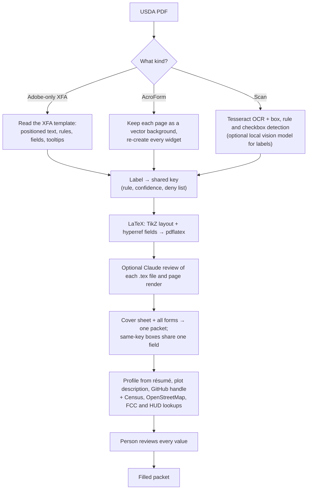

Farmers applying for a USDA loan or program fill out a stack of forms that ask the same questions again and again: name, address, county, phone. Many of those forms are *dynamic XFA* files. Opened in a browser, in Preview, or in most PDF tools, they show one page that says the document "requires Adobe Reader 8 or higher".

The Forms Engine rebuilds each form as LaTeX and compiles it to an ordinary fillable PDF. It then links every box that asks for the same thing into a single PDF field. Type a first name once on the cover sheet, and every name, full-name and name-and-address box in the packet updates.

<figure>
  
  <figcaption>AD-2047 as delivered: most viewers only see this placeholder.</figcaption>
</figure>
<figure>
  
  <figcaption>The same form rebuilt from its XFA template via LaTeX, filled for a fictional applicant.</figcaption>
</figure>

## How it works

Docling also turns each rebuilt form into a readable, reflowed LaTeX document for search and screen readers. The positioned `.tex` file reproduces the page; the readable one follows document order.

## Measured on the demo set

| Form | Input | Pages | Fields | Linked to the cover sheet |
|---|---|---|---|---|
| AD-2047 Customer Data Worksheet | Adobe-only XFA | 2 | 57 | 7 |
| CCC-941 AGI Certification and Consent | Adobe-only XFA | 4 | 9 | 1 |
| FSA-2001 Request for Direct Loan Assistance | AcroForm | 14 | 1,097 | 11 |
| AD-3030 Representations Regarding Felony Conviction and Tax Delinquent Status | AcroForm | 1 | 10 | 2 |
| CCC-860 (rasterized to a 150 dpi scan) | Scan | 4 | 24 detected | 0 |

- **Packet:** the 1,215 boxes become 1,194 fields, and 15 shared keys cover 36 boxes. Conversion takes about 40 seconds on 2 CPUs, or about 5 minutes with the readable docling export.
- **Fill:** the fictional applicant's résumé and plot description filled 29 boxes from 13 values. The county (Lubbock) came from the plot description, via OpenStreetMap and the FCC Census Area API. HUD data identified the Lubbock, TX HUD Metro Fair Market Rent area, outside any Qualified Census Tract.
- **Scans:**
  - On a rasterized AD-3030, the engine found 10 of 10 fields and labelled each correctly from OCR.
  - On CCC-860 it found 9 of 16 fields, plus false positives.
  - Scanned forms are therefore never linked to the cover sheet without review.

## Downloads

All values in the filled packet belong to a fictional applicant.

- [Blank consolidated packet (PDF, 2.1 MB)]({{ '/assets/apps/forms-engine/usda-packet-blank.pdf' | relative_url }}): open it in Acrobat, Firefox or Chrome, type a first name on the cover sheet, and watch every linked box change.
- [Packet filled for the fictional applicant (PDF, 2.0 MB)]({{ '/assets/apps/forms-engine/usda-packet-filled-fictional.pdf' | relative_url }})
- [LaTeX sources for every form, plus the readable exports (ZIP, 2.3 MB)]({{ '/assets/apps/forms-engine/latex-sources.zip' | relative_url }})
- [Field manifest with linking rules and confidences (JSON)]({{ '/assets/apps/forms-engine/manifest.json' | relative_url }}) · [Applicant profile with provenance (JSON)]({{ '/assets/apps/forms-engine/profile-fictional.json' | relative_url }})

<figure>
  
  <figcaption>The cover sheet: one box per shared key, listing every form and page it fills. Grey boxes are computed from the parts above them.</figcaption>
</figure>

## What keeps it trustworthy

- **Sensitive boxes are never filled and never linked.** That covers taxpayer IDs, birth dates, signatures, signature dates, bank details, and race, ethnicity, sex and veteran questions. A full TIN box and a "last 4 digits" box must never share a value.
- **Boxes about other people stay separate.** Sections about entity members, spouses, lenders or the county office are not linked to the applicant.
- **Every link and every value can be checked.** Each link records the rule that made it and a confidence score. Each filled value records its source and evidence. The person reviews and edits everything before the packet is filled.
- **The model passes are optional, logged and narrow.**
  - The local vision model only proposes labels for scanned fields.
  - The Claude review reads each generated `.tex` file with a rendering of the page. It may change field labels only, and every change is listed in the manifest. Its other findings are reported for a person to act on.
- **Nothing is kept.** Jobs are deleted after an hour. The only outside calls go to public data services: the Census geocoder, OpenStreetMap, the FCC Area API and HUD's open GIS layers.

## Deployment

The service is a FastAPI app with a small web UI, packaged as a multi-architecture container image.

- **Status:** the image builds in GitHub Actions and is published to GHCR. The Kubernetes manifests target **Oracle Cloud's Always Free OKE**: Ampere A1 Arm nodes and one free flexible load balancer.
- **Live URL:** it will be linked here once the cluster is up.
- **Run it yourself:** follow the [README](https://github.com/sweeden-ttu/profile/tree/stable/services/forms-engine).
