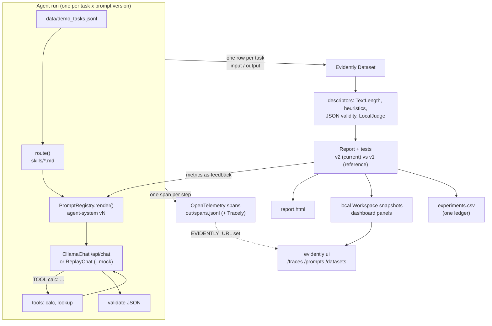

<link rel="stylesheet" href="{{ '/assets/toolkit/toolkit.css' | relative_url }}">

**Where it lives:** `toolkit-src/evidently-llama/` in
[sweeden-ttu/profile](https://github.com/sweeden-ttu/profile/tree/stable/toolkit-src/evidently-llama).
Copy the folder into a project, point it at a local model, and you get an evaluation loop that
treats a small agent like any other ML system: logged inputs and outputs, row-level scores,
thresholded tests, and a dashboard that tracks every prompt change. It's built on
**Evidently 0.7.23** (the 0.7 API: `from evidently import Dataset, Report`) and pinned in
`requirements.txt`.

```bash
cd toolkit-src/evidently-llama
pip install -r requirements.txt          # Python >= 3.11; set DO_NOT_TRACK=1 to disable Evidently telemetry
python -m evllama demo --mock            # no Ollama: replays data/recordings/demo.json
# live, against your own model:
ollama serve & ollama pull llama3.2:1b
python -m evllama demo                   # LLAMA_MODEL / OLLAMA_HOST override the defaults
python -m evllama demo --record          # live, and refresh the recordings --mock replays
evidently ui --workspace out/workspace   # dashboard at http://localhost:8000
python -m unittest discover -s tests     # offline smoke tests
```

## Architecture

<div class="tk-wide" markdown="1">



</div>

Each kind of artifact goes to exactly one Evidently surface. That rule is what keeps a project
readable after fifty runs:

<div class="tk-scroll" markdown="1">

| What | Where it goes | Template module |
|---|---|---|
| Agent inputs and outputs (`input`, `output` + metrics columns) | `Dataset` → Report | `datasets.py` |
| A prompt and the feedback it earned | Prompt **version**: user/system message = prompt, assistant message = feedback | `prompts.py` |
| Each agent step (route, llm, tool, validate, judge) | Span in the project's **one** tracing dataset, `trace` | `tracing.py` |
| Each evaluated configuration | Row in the **one** `experiments` ledger (append-only) | `datasets.py` |
| An evaluation run | Report snapshot (`add_run(include_data=False)`) | `dashboard.py` |

</div>

With no server, all of this stays on disk. Set `EVIDENTLY_URL` (for example
`http://localhost:8000`, from `evidently ui`) and the same run also pushes prompts over REST,
spans through Tracely's OTLP exporter, ledger rows, and snapshots. I checked this push path
against a local Evidently UI 0.7.23.

```text
evidently-llama/
├─ evllama/           llm · prompts · tracing · datasets · descriptors · reports · dashboard · skills · agent · cli
├─ skills/            calculator.md  extractor.md  docs_qa.md  summarizer.md  general.md
├─ prompts/           registry.json        (versioned prompts, committed)
├─ data/              demo_tasks.jsonl  docs.json  recordings/demo.json
├─ tools/             make_mock_recordings.py
└─ tests/             test_smoke.py
```

## The pieces, in code

**Backends.** The Ollama client is about 20 lines of standard-library `urllib`.
`ReplayChat` keys each recording by a hash of the request: messages plus format, not model
name. A rerun with the same prompts is therefore exact. A request it hasn't seen falls back to
the nearest recorded one and is labelled `nearest`.

```python
def request_key(messages, fmt=None) -> str:
    payload = json.dumps({"messages": messages, "format": fmt}, sort_keys=True, ensure_ascii=False)
    return hashlib.sha256(payload.encode("utf-8")).hexdigest()[:16]

def make_chat(settings):
    if settings.mock:
        return ReplayChat.from_files([settings.recordings], model=settings.model)
    live = OllamaChat(settings.model, settings.ollama_host)   # temperature 0, seed 42
    return RecordingChat(live, settings.recordings) if settings.record else live
```

**Traces.** Every step is a span with the same core attributes (`kind`, `statement`, `input`,
`output`) plus step metrics, so the trace table has the same columns whoever logged it.

```python
with self.tracer.span("llm", kind="llm", input=messages[-1]["content"], statement="chat completion") as s:
    resp = self.chat.chat(messages, fmt)
    self.tracer.set(s, output=resp.text, latency_ms=resp.latency_ms, prompt_tokens=resp.prompt_tokens,
                    completion_tokens=resp.completion_tokens, model=resp.model, replay_match=resp.match)
```

**Prompts.** Each version stores the prompt and the feedback it received. A different
verdict on an already-answered version becomes a new version, so the history of what you
believed stays visible.

```python
registry.render("agent-system", 2, task=task, skill=skill.name, tools="calc")
registry.record_feedback("agent-system", 2,
    "judge 4.9/5, mean latency 925.53 ms, invalid JSON 0, refusals 0, tests 20/20", metrics)
```

**Skills.** A skill is a Markdown file the agent loads. Routing is keyword scoring, so it
can't drift between runs.

```markdown
---
name: calculator
description: Arithmetic word problems; the math is delegated to the deterministic calc tool.
triggers: [calculate, how many, how much, total, percent, "%", times, reduction]
tools: [calc]
output: text
---
Translate the question into a single arithmetic expression and let the calc tool compute it.
```

**Descriptors, judge, tests.** Descriptor tests become per-row checks, `TestSummary` rolls
them up, and dataset-level tests turn the Report into a test suite you can gate CI on.

```python
judge = LocalJudge(chat, registry, tracer)            # same local model, prompt "judge" v1
ds = Dataset.from_pandas(df, data_definition=DataDefinition(text_columns=["input", "output"], ...),
                         descriptors=standard_descriptors(judge))
report = Report([TextEvals(columns=[...]), RowCount(),
                 MeanValue(column="latency_ms", tests=[lte(4000)]),
                 CategoryCount(column="json_valid", category="invalid", tests=[eq(0)]),
                 MeanValue(column="judge_score", tests=[gte(3.5)]), ...], include_tests=True)
snapshot = report.run(current, reference)             # prompt v2 vs v1, side by side
```

**Dashboard.** The project is created once with its panels. Each eval run adds one snapshot,
so every panel gains a point per prompt version.

```python
project.dashboard.add_panel(line_plot_panel(title="LLM-as-judge score (1-5)", size="half",
    values=[PanelMetric(legend="judge", metric="MeanValue", metric_labels={"column": "judge_score"})]))
ws.add_run(project.id, snapshot, include_data=False)
```

## Metrics

<div class="tk-scroll" markdown="1">

| Column / metric | Kind | How it is computed | Test |
|---|---|---|---|
| `output_chars`, `output_words`, `output_sentences` | built-in descriptor | `TextLength`, `WordCount`, `SentenceCount` | chars ≤ 1200 per row |
| `sentiment_heuristic` | custom, offline | lexicon (positive − negative) / total, range −1..1 | (reported) |
| `toxicity` | custom, offline | blocklist match → `flagged` / `clean` | 0 flagged |
| `refusal` | custom, offline | regex for “I can't / I'm unable / as an AI …” | 0 refusals |
| `pii` | custom, offline | email / phone regex | (reported) |
| `json_valid` | custom, row-aware | parses the first JSON object, only where the skill expects JSON (`n/a` otherwise) | 0 invalid |
| `judge_score` | LLM-as-judge | local model with the versioned `judge` prompt, parses `SCORE: n` (1-5) | ≥ 3 per row, mean ≥ 3.5 |
| `latency_ms` | from spans | total LLM latency per task (recorded latency when replaying) | mean ≤ 4000 ms |
| `tool_success` | from spans | 1 if every tool call in the task succeeded | mean ≥ 0.9 |
| `llm_calls`, `tool_calls`, `prompt_tokens`, `completion_tokens` | from Ollama | `prompt_eval_count`, `eval_count` per call | (reported) |
| `row_tests` | `TestSummary` | all / share of row-level tests passed | (reported) |

</div>

Evidently's built-in `Sentiment()` needs an NLTK download, and `HuggingFaceToxicity()` needs a
Hugging Face model. That's why the offline defaults are heuristics. If you `pip install litellm`,
Evidently's own `LLMEval(provider="ollama", ...)` judges can also call Ollama directly.
The template's `LocalJudge` avoids that dependency.

## Sample report

This run used `--mock`. Ten synthetic tasks ran with prompt v1 (generic assistant) and v2
(explicit tool protocol, "final answer only"). The recorded responses are hand-written
stand-ins for typical `llama3.2:1b` behaviour, produced by `tools/make_mock_recordings.py`.
Run `--record` against your own Ollama to replace them.

<div class="tk-scroll" markdown="1">

| Prompt | Judge mean (1-5) | Mean latency | Invalid JSON | Refusals | Tests passed |
|---|---|---|---|---|---|
| `agent-system` v1 | 2.2 | 774 ms | 1 | 1 | 15 / 20 |
| `agent-system` v2 | 4.9 | 926 ms | 0 | 0 | 20 / 20 |

</div>

v2 costs about 150 ms more per task because it makes a second call after each tool result.
That's the kind of tradeoff the dashboard is there to show.

<div class="tk-wide">
  <iframe class="tk-report" src="{{ '/assets/toolkit/evidently/sample-report.html' | relative_url }}" title="Evidently sample report: prompt v2 vs v1" loading="lazy"></iframe>
  <p class="tk-note">Open the <a href="{{ '/assets/toolkit/evidently/sample-report.html' | relative_url }}">report full-screen</a>.
  Raw artifacts from the same run:
  <a href="{{ '/assets/toolkit/evidently/dataset-sample.csv' | relative_url }}">dataset with descriptors (CSV)</a> ·
  <a href="{{ '/assets/toolkit/evidently/trace-sample.json' | relative_url }}">one trace (spans JSON)</a> ·
  <a href="{{ '/assets/toolkit/evidently/prompts.json' | relative_url }}">prompt registry</a> ·
  <a href="{{ '/assets/toolkit/evidently/experiments.csv' | relative_url }}">experiments ledger</a> ·
  <a href="{{ '/assets/toolkit/evidently/summary.json' | relative_url }}">summary</a>.
  The report loads Evidently's 3.5 MB viewer bundle once from <code>assets/toolkit/evidently/lib/</code>
  (Apache-2.0), so each committed report is tens of KB instead of 3.7 MB.</p>
</div>

The same template powers the [Llama agents in the browser]({{ '/toolkit/llama-agents/' | relative_url }})
page. There, GitHub Actions runs four agent examples live on Ollama and logs them through
`evllama`. The [latest CI report]({{ site.data.agent_runs.latest.report | default: '/toolkit/llama-agents/' | relative_url }})
is rebuilt on every run.
