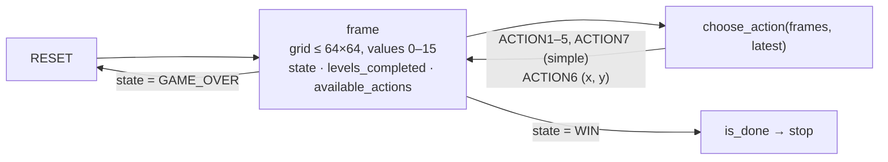

> **Status (26 Oct 2026):** open. Today is the entry and team-merger deadline. **Final submission: Mon 2 Nov 2026, 23:59 UTC.** Both milestone prizes (30 Jun, 30 Sep) have passed. [Competition page](https://www.kaggle.com/competitions/arc-prize-2026-arc-agi-3) · [docs.arcprize.org](https://docs.arcprize.org/) · [paper track](/toolkit/notes/kaggle-paper-tracks/) (due 9 Nov).

## What is different from ARC-AGI-2

ARC-AGI-2 shows you demonstrations and asks for an answer. ARC-AGI-3 gives you **no instructions at all**. Your agent is dropped into a hand-crafted turn-based **game** and has to find out by acting what the controls do, what the goal is, and how to reach it, level after level. The benchmark measures exploration, memory, goal acquisition and efficiency together.



## Frames and actions

| Field | Meaning |
|---|---|
| `frame` | One or more grids, each at most **64×64**, with cell values **0–15**. (0, 0) is the top-left cell |
| `state` | `NOT_PLAYED`, `NOT_FINISHED`, `WIN` or `GAME_OVER` |
| `levels_completed` / `win_levels` | Progress through the game's levels (renamed from `score` / `win_score` in agents v0.9.3) |
| `available_actions` | Which of the seven actions this game accepts |

| Action | Kind |
|---|---|
| `RESET` | Start or restart the game |
| `ACTION1`–`ACTION5`, `ACTION7` | Simple (often move up/down/left/right or interact, but **the meaning varies per game**) |
| `ACTION6` | Complex: needs `{"x": 0..63, "y": 0..63}` coordinates |

## Scoring: completion × efficiency, squared

For every level the agent completes, its action count is compared with a **human baseline**: the actions first-time human testers needed.

$$
s_\ell = \min\!\left(\frac{h_\ell}{a_\ell},\, 1\right)^{2},
\qquad
S_{\text{game}} = \frac{\sum_\ell \ell \cdot s_\ell}{\sum_\ell \ell},
\qquad
S = \operatorname{mean}_{\text{games}} S_{\text{game}}
$$

Here $$h_\ell$$ is the human action count for level $$\ell$$ (1-indexed) and $$a_\ell$$ is the agent's. An unfinished level scores 0. Two consequences:

- **Inefficiency is punished quadratically.** Twice the human action count is worth a quarter of the points.
- **Later levels weigh more.** Level 8 counts eight times as much as level 1.

**Worked example.** The public game `ar25` stores its human baselines in `metadata.json` as `baseline_actions = [32, 50, 75, 37, 89, 159, 233, 73]`. With those baselines:

| Agent behaviour on ar25 | Game score |
|---|---|
| Human-level action count on all 8 levels | 100.0% |
| 2× the human actions on all 8 levels | 25.0% |
| Levels 1–4 at human pace, stuck on 5 | 27.8% |
| Levels 1–4 at 2× human actions | 6.9% |
| Only level 1, at human pace | 2.8% |

*Computed with the formula above. Scores are capped at 100%, so beating the human count earns nothing extra.*

The evaluation uses a **private set of 110 games** the agent has never seen: 55 for the public leaderboard and 55 for the private one. There are 25 public practice games in `environment_files/`.

## The agent interface

The [ARC-AGI-3-Agents](https://github.com/arcprize/ARC-AGI-3-Agents) framework (a copy is in the competition data) asks for two methods. A `Swarm` runs one agent per game in parallel and manages the scorecard.

```python
from arcengine import FrameData, GameAction, GameState
from agents.agent import Agent

class Explorer(Agent):
    MAX_ACTIONS = 400                                   # hard cap: the base loop also stops here

    def is_done(self, frames: list[FrameData], latest: FrameData) -> bool:
        return latest.state is GameState.WIN

    def choose_action(self, frames: list[FrameData], latest: FrameData) -> GameAction:
        if latest.state in (GameState.NOT_PLAYED, GameState.GAME_OVER):
            return GameAction.RESET
        action = self.next_untried_action(latest)       # your policy goes here
        if action.is_complex():
            action.set_data({"x": 32, "y": 32})
        action.reasoning = "explore"                    # free-text, kept in recordings
        return action
```

Run it locally with `uv run main.py --agent=<name> --game=<game_id>`.
- **Offline:** the `arc-agi` toolkit (v0.9.3+) runs environments locally from the game files.
- **Online:** set `ONLINE_ONLY=True` and an `ARC_API_KEY` from three.arcprize.org to use the hosted API and replays.

## Compute and rules

| Constraint | Value |
|---|---|
| Runtime | CPU or GPU notebook, **≤ 9 h** |
| Internet | off |
| Submission file | generated automatically. Any action on any game produces a file covering all games |
| Hardware | RTX 6000 (`g4-standard-48`) machines, reserved for this competition |
| Prizes (USD 850k) | USD 75k final-leaderboard prizes (top 5); USD 700k bonus only if a team reaches **100%** |
| Open source | required for prize eligibility |

## Strategy notes

1. **Model the game, not the pixels.** Hash each frame, and keep a graph of `(frame hash, action) → next frame hash`. Most early progress comes from not repeating moves that didn't change anything.
2. **Learn what each action does in a few probes.** Try each available action once from the start state and record the diff: which cells changed and by how much. A move action shifts a blob; an interact action changes a colour. Re-probe after every `RESET`, because meanings are per game.
3. **Hunt for the goal signal.** `levels_completed` increments on success. Breadth-first search over the frame graph toward novel states finds the first win, and **the second time through, replay the shortest known path**. Efficiency is squared, so re-solving a known level with fewer actions pays.
4. **Treat `ACTION6` coordinates as a structured search.** Click object centroids (connected components of non-background cells) before scanning all 4,096 cells.
5. **Budget the 9 hours.** 110 games × levels × actions × model latency is the real constraint. A cheap symbolic explorer with an LLM called only at decision points beats an LLM on every step.
6. **Cap `MAX_ACTIONS`.** The base loop stops at `MAX_ACTIONS`, and a runaway agent burns the time limit for every other game.

## Checklist before 2 Nov

- [ ] The agent beats at least one public game end-to-end **offline**, from the copies in `environment_files/`.
- [ ] Per-game wall-clock × 110 games, plus margin, fits under 9 h.
- [ ] `is_done` stops on `WIN`, and `GAME_OVER` triggers a `RESET`, never an exit.
- [ ] Recordings are on for local runs, so the paper track can show real trajectories.
- [ ] A [paper-track writeup](/toolkit/notes/kaggle-paper-tracks/) is drafted (due 9 Nov).

*Sources: the competition's Overview, Data, Evaluation, Timeline, Prizes and Code Requirements pages, read on 26 Oct 2026 via the Kaggle CLI. The agent interface comes from `ARC-AGI-3-Agents/agents/agent.py` and `templates/random_agent.py`, and the baselines from `environment_files/ar25/0c556536/metadata.json`.*
